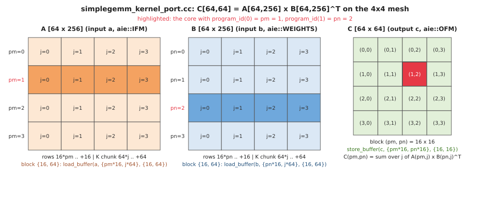
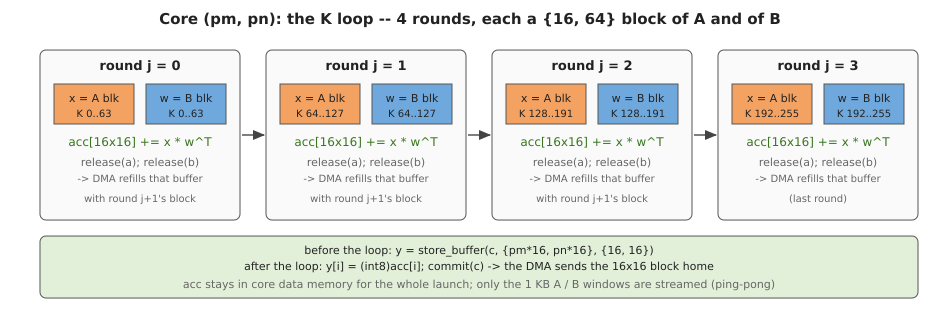
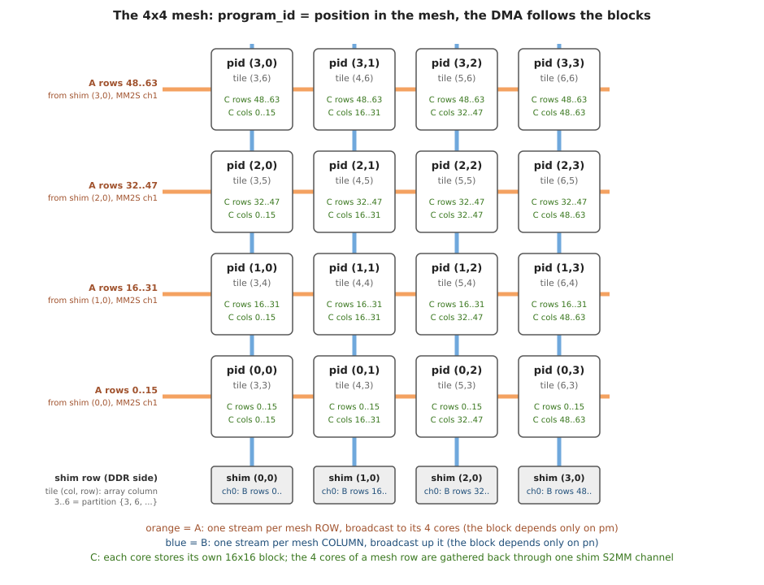

# Tutorial 1 -- GEMM on a 4x4 tile mesh

Example: [`example/tileprogram/ccode/simplegemm_kernel_port.cc`](../../example/tileprogram/ccode/simplegemm_kernel_port.cc)
(56 lines, host included). Shared host helpers: `simplegemm_load.h`.

## The whole program

This is the whole program -- kernel and host. There is no DMA, routing or buffer code
anywhere: the compiler derives all of it from the kernel's `load_buffer` / `store_buffer`
calls. The rest of this tutorial explains it line by line.

<!-- code: example/tileprogram/ccode/simplegemm_kernel_port.cc -->
```cpp
/******************************************************************************
 * Copyright (C) 2026 Advanced Micro Devices, Inc. All Rights Reserved.
 * SPDX-License-Identifier: Apache-2.0
 * Kernel-only GEMM: the DMA is derived from the kernel.
 *   C[64, 64] = A[64, 256] x B[64, 256]^T, int8, on the 4x4 mesh
 ******************************************************************************/
#include "simplegemm_load.h"
__global__ void gemm(aie::port<input_window_int8 *, aie::IFM, aie::shape<64, 256>> a,
                     aie::port<input_window_int8 *, aie::WEIGHTS, aie::shape<64, 256>> b,
                     aie::port<output_window_int8 *, aie::OFM, aie::shape<64, 64>> c) {
    const int tm = 16, tn = 16, tk = 64; // C block per core, K chunk per round
    const int pm = aie::program_id(0);   // mesh row: which 16 rows of C
    const int pn = aie::program_id(1);   // mesh col: which 16 columns of C
    int8_t *y = aie::store_buffer(c, {pm * tm, pn * tn}, {tm, tn});
    int acc[tm * tn];
    for (int i = 0; i < tm * tn; i++)
        acc[i] = 0;
    for (int j = 0; j < 256 / tk; j++) { // K chunks
        const int8_t *x = aie::load_buffer(a, {pm * tm, j * tk}, {tm, tk});
        const int8_t *w = aie::load_buffer(b, {pn * tn, j * tk}, {tn, tk});
        for (int m = 0; m < tm; m++)
            for (int n = 0; n < tn; n++) {
                int s = 0;
                for (int k = 0; k < tk; k++)
                    s += x[m * tk + k] * w[n * tk + k];
                acc[m * tn + n] += s;
            }
        aie::release(a);
        aie::release(b);
    }
    for (int i = 0; i < tm * tn; i++)
        y[i] = (int8_t)acc[i];
    aie::commit(c);
}

int main() {
    printf("=== Kernel-only GEMM (DMA from the kernel's blocks) on AIE %dx%d ===\n", HW_ROWS, HW_COLS);
    printf("    C[%dx%d] = A[%dx%d] x B^T[%dx%d], int8\n", GEMM_M, GEMM_N, GEMM_M, GEMM_K, GEMM_K, GEMM_N);
    aieSetDevice(0);
    aieArray device;
    aieMesh mesh = device.partition({3, 6, 0, 6}, HW_ROWS, HW_COLS);
    int8_t *A = (int8_t *)__Runtime_Alloc(GEMM_M * GEMM_K);
    int8_t *B = (int8_t *)__Runtime_Alloc(GEMM_N * GEMM_K);
    int8_t *C = (int8_t *)__Runtime_Alloc(GEMM_M * GEMM_N);
    gemm_init(A, B, C);
    XTime t0, t1;
    XTime_GetTime(&t0);
    gemm<<<mesh>>>(A, B, C);
    XTime_GetTime(&t1);
    printf("[BENCH] aie_wall_ms=%.3f\n", 1.0 * (t1 - t0) / COUNTS_PER_SECOND * 1000.0);
    const int mismatches = gemm_verify(A, B, C);
    free(A);
    free(B);
    free(C);
    return mismatches ? 1 : 0;
}
```
<!-- /code -->

```
C[64, 64] = A[64, 256] x B[64, 256]^T        int8 in, int32 accumulate, int8 out
```

You will learn the whole kernel-only model in one small file:

- a **port** declares a tensor the kernel reads or writes;
- `aie::program_id(0/1)` says **which core** of the mesh is running;
- `aie::load_buffer` / `aie::store_buffer` name, in tensor coordinates, the
  **block** this core uses now; `aie::release` / `aie::commit` hand it back;
- the compiler **runs your kernel on x86 for every core**, records the blocks,
  and turns them into DMA programs and stream routes.

## 1. The idea: one output block per core

The AIE array we use is a 4 x 4 mesh of cores. Split C into 4 x 4 blocks of
16 x 16 and give one block to each core. Core `(pm, pn)` computes

```
C[16pm .. 16pm+15, 16pn .. 16pn+15] = sum over j of  A[16pm.., 64j..] x B[16pn.., 64j..]^T
```

It needs a 16-row band of A and a 16-row band of B. Both bands are 16 x 256 =
4 KB, too much to stream as one piece next to everything else, so the core walks
K in **4 chunks of 64**: round `j` brings a `{16, 64}` block of A and of B.



Two facts fall out of this picture, and the compiler finds both by itself:

- every core of mesh **row** `pm` uses the same A blocks, so A can be sent once
  per mesh row and **broadcast** along it;
- every core of mesh **column** `pn` uses the same B blocks: one stream per
  mesh column, broadcast down it.

## 2. The kernel, line by line

```cpp
#include "simplegemm_load.h"
```
Host-side helpers only: the sizes (`GEMM_M/N/K`, `HW_ROWS/COLS` = 4 x 4),
`gemm_init()` (deterministic test data) and `gemm_verify()` (CPU GEMM + compare).
The kernel uses none of it -- aiehlc splits the file into a host part and a
kernel part, and the kernel part sees only the `__global__` function.

```cpp
__global__ void gemm(aie::port<input_window_int8 *, aie::IFM, aie::shape<64, 256>> a,
                     aie::port<input_window_int8 *, aie::WEIGHTS, aie::shape<64, 256>> b,
                     aie::port<output_window_int8 *, aie::OFM, aie::shape<64, 64>> c) {
```
`__global__` marks the function that runs on **every core** of the mesh.
Each parameter is a **port**: `aie::port<WindowType, Role, aie::shape<...>>`.

| Part | Meaning |
|---|---|
| `input_window_int8 *` / `output_window_int8 *` | direction and element type: the core *receives* blocks of an input, *produces* blocks of an output. Always a pointer. |
| `aie::IFM` / `aie::WEIGHTS` / `aie::OFM` | role tag. Optional: `aie::port<T, aie::shape<64, 256>> a` works too (output -> OFM, an input broadcast along mesh columns -> WEIGHTS, other inputs -> IFM). It names the generated descriptor; it does not change the DMA. |
| `aie::shape<64, 256>` | the **whole tensor** as it lies in DDR (row-major). Block offsets below are in these coordinates. |

At the call site the ports are plain host pointers: `gemm<<<mesh>>>(A, B, C)`.

```cpp
    const int tm = 16, tn = 16, tk = 64; // C block per core, K chunk per round
```
The tiling is ordinary C++ in the kernel: a 16 x 16 C block per core, K in
chunks of 64. Change these numbers and the DMA changes with them.

```cpp
    const int pm = aie::program_id(0);   // mesh row: which 16 rows of C
    const int pn = aie::program_id(1);   // mesh col: which 16 columns of C
```
`program_id(0)` is this core's **mesh row** (0..3), `program_id(1)` its **mesh
column** (0..3) -- Triton's `tl.program_id`. On the core they compile to the
core's hardware id minus the first core of the placement (generated code:
`pm = (get_coreid() & 0x1F) - 3`, `pn = (get_coreid() >> 16) - 3`). See
section 4 for which physical tile is which pid.

```cpp
    int8_t *y = aie::store_buffer(c, {pm * tm, pn * tn}, {tm, tn});
```
"This core writes the `{16, 16}` block of C at row `16pm`, column `16pn`."
`store_buffer(port, offset, shape)` takes the offset and shape **in tensor
coordinates** and returns a pointer to a core-local buffer of exactly that
shape (row-major, `y[m * 16 + n]`). The compiler made the DMA that will carry
this buffer to `C` in DDR when you `commit`.

```cpp
    int acc[tm * tn];
    for (int i = 0; i < tm * tn; i++)
        acc[i] = 0;
```
A 16 x 16 int32 accumulator in the core's local data memory (1 KB). It stays
there for all 4 K rounds; only A and B blocks are streamed.

```cpp
    for (int j = 0; j < 256 / tk; j++) { // K chunks
        const int8_t *x = aie::load_buffer(a, {pm * tm, j * tk}, {tm, tk});
        const int8_t *w = aie::load_buffer(b, {pn * tn, j * tk}, {tn, tk});
```
Round `j` (4 rounds): the `{16, 64}` block of A at row `16pm`, column `64j`,
and the matching block of B at row `16pn`. `load_buffer` waits until the DMA
has filled the core's buffer and returns it (`x[m * 64 + k]`). On the device
a load **does not fetch** anything: the DMA streams the blocks in the order
the compiler derived from your loop, and `load_buffer` takes the next one. That
is why the loops must be regular -- offsets affine in `program_id` and the
loop indices, one block shape per port.

```cpp
        for (int m = 0; m < tm; m++)
            for (int n = 0; n < tn; n++) {
                int s = 0;
                for (int k = 0; k < tk; k++)
                    s += x[m * tk + k] * w[n * tk + k];
                acc[m * tn + n] += s;
            }
```
Plain scalar C++: a 16 x 16 x 64 matrix product on the two blocks, B used
transposed (`w[n * tk + k]` is row `n` of B). Tutorial 4 replaces loops like
this with `aie::mmul`.

```cpp
        aie::release(a);
        aie::release(b);
    }
```
"I am done with this round's A and B blocks." The buffer goes back to the DMA,
which can refill it with round `j + 1`'s block. Every port is **double
buffered** by default (ping-pong), so round `j + 1` is usually already in the
other buffer while you compute round `j`.

```cpp
    for (int i = 0; i < tm * tn; i++)
        y[i] = (int8_t)acc[i];
    aie::commit(c);
}
```
Write the result into the output block and `commit` it: the DMA sends the
16 x 16 block to `C[16pm.., 16pn..]` in DDR.



## 3. The host, line by line

```cpp
int main() {
    printf("=== Kernel-only GEMM (DMA from the kernel's blocks) on AIE %dx%d ===\n", HW_ROWS, HW_COLS);
    printf("    C[%dx%d] = A[%dx%d] x B^T[%dx%d], int8\n", GEMM_M, GEMM_N, GEMM_M, GEMM_K, GEMM_K, GEMM_N);
```
Runs on the Arm (A78) next to the array; ordinary C++.

```cpp
    aieSetDevice(0);
    aieArray device;
```
Select the device and create the array object (`aieSetDevice` is a no-op kept
for CUDA-like source compatibility).

```cpp
    aieMesh mesh = device.partition({3, 6, 0, 6}, HW_ROWS, HW_COLS);
```
Reserve a **partition** and describe the mesh the kernel runs on. The first
argument is `{startCol, endCol, startRow, endRow}` of the array: columns 3..6,
four columns, which the runtime initializes (`__Runtime_init_mesh_partition_with`)
and programs with this app's stream routing. `HW_ROWS x HW_COLS` = 4 x 4 is
the mesh: `aie::program_id` ranges over it, and the compiler places the 16
cores in it. The compiler also **reads this call** -- it is how the kernel
analysis knows to trace a 4 x 4 mesh.

```cpp
    int8_t *A = (int8_t *)__Runtime_Alloc(GEMM_M * GEMM_K);
    int8_t *B = (int8_t *)__Runtime_Alloc(GEMM_N * GEMM_K);
    int8_t *C = (int8_t *)__Runtime_Alloc(GEMM_M * GEMM_N);
    gemm_init(A, B, C);
```
DDR buffers the AIE DMA can reach, sized like the ports' `aie::shape` (16 KB,
16 KB, 4 KB). `gemm_init` fills A with values in [-4, 4] and B with {-1, 0, 1}
(so a dot product of 256 fits easily) and zeroes C.

```cpp
    XTime t0, t1;
    XTime_GetTime(&t0);
    gemm<<<mesh>>>(A, B, C);
    XTime_GetTime(&t1);
    printf("[BENCH] aie_wall_ms=%.3f\n", 1.0 * (t1 - t0) / COUNTS_PER_SECOND * 1000.0);
```
The **launch**, CUDA-style. aiehlc rewrites it into
`__aie_launch("gemm", mesh, A, 16384, B, 16384, C, 4096)`, which flushes the
inputs from the cache, loads the kernel ELF into all 16 cores, programs every
DMA buffer descriptor and lock the compiler derived (`host_canonicalized`, the
generated `host.cc`), starts the cores and the shim DMAs, and waits for the
last output block. When it returns, `C` holds the result. `XTime` measures the
whole launch.

```cpp
    const int mismatches = gemm_verify(A, B, C);
    free(A);
    free(B);
    free(C);
    return mismatches ? 1 : 0;
}
```
Compare with a CPU GEMM (`PASS: all 4096 output elements match.`).

## 4. How the pids land on the hardware



| pid `(pm, pn)` | array tile `(col, row)` | A rows | B rows | C block |
|---|---|---|---|---|
| (0, 0) | (3, 3) -- partition col 0 | 0..15 | 0..15 | rows 0..15, cols 0..15 |
| (0, 3) | (6, 3) | 0..15 | 48..63 | rows 0..15, cols 48..63 |
| (3, 0) | (3, 6) | 48..63 | 0..15 | rows 48..63, cols 0..15 |
| (pm, pn) | (3 + pn, 3 + pm) | 16pm.. | 16pn.. | (16pm.., 16pn..) |

Mesh row `pm` is array row `3 + pm` (row 3 is the core row closest to the
shim row), mesh column `pn` is partition column `pn` = array column `3 + pn`.
The derived data movement (from the generated `host.cc` and routing):

- **A**: shim tile of column `pm`, MM2S channel 1, streams A rows
  `16pm..16pm+15` in 4 blocks of 16 x 64 and broadcasts them to the 4 cores of
  mesh row `pm`;
- **B**: shim tile of column `pn`, MM2S channel 0, streams B rows
  `16pn..16pn+15` to the 4 cores of mesh column `pn`;
- **C**: the 4 cores of a mesh row are gathered back through one shim S2MM
  channel, each 16 x 16 block to its own place in `C`.

8 input streams instead of 32: the broadcast is the point of the 2-D split.

## 5. What the compiler made of it

The build log shows the kernel analysis -- read it after every change:

```
[KernelAnalysis] gemm: traced on the 4x4 mesh
  a (IFM, tensor (64,256)): block (16,64), core offset (16,0)*p0 + (0,0)*p1, rounds 1x4 steps (0,0) / (0,64)
  b (WEIGHTS, tensor (64,256)): block (16,64), core offset (0,0)*p0 + (16,0)*p1, rounds 1x4 steps (0,0) / (0,64)
  c (OFM, tensor (64,64)): block (16,16), core offset (16,0)*p0 + (0,16)*p1, rounds 1x1 steps (0,0) / (0,0)
  routing plan on the 4x4 mesh:
    a (IFM, row broadcast, 1x4 blocks/core): d1[64]=rows/4@16 d2[256]=j4x64@64
    b (WEIGHTS, col broadcast, 1x4 blocks/core): d1[64]=cols/4@16 d2[256]=j4x64@64
    c (OFM, gather, 1x1 blocks/core): d1[64]=rows/4@16 d2[64]=cols/4@16
  => routed: 3 ports on the 4x4 mesh, DMA carriers taken from the traced blocks
```

How to read it: the kernel was run on x86 for all 16 `(p0, p1)` and every
`load_buffer` / `store_buffer` recorded. Each port's blocks were fitted to
`offset = base_p0*p0 + base_p1*p1 + step_i*i + step_j*j` with one block shape
-- exactly what a DMA buffer descriptor can do. `a` moves with `p0` only (row
broadcast), `b` with `p1` only (column broadcast), `c` with both (gather).
`d2[256]=j4x64@64` = "dim 2 of 256 is walked by the inner loop, 4 rounds of 64,
step 64".

The source is then rewritten with explicit descriptors (`aout/newfile.cpp`):

```cpp
constexpr aie::GemmSpace __aie_gemm_IFM = {
    .policy = {.map = {.act = aie::Pattern::Broadcast, .layout = aie::Layout::Row}, ...
               .sched = {.pp_depth = 2, .l1_budget = aie::Bytes{4096}}},
    .d1 = {.fullsize = 64, .tile_round = 4, .tile_size = 16, .stride = 16},
    .d2 = {.fullsize = 256, .tile_round = 4, .tile_size = 64, .stride = 64}};
```

and the MLIR pipeline lowers those to `host.cc` (DMA buffer descriptors,
locks, launch), `kernel.cc` (the core's `main()`: 1 KB ping + 1 KB pong per
input, the output block, your function) and `routing.cc` (stream switches).
In the shim, A's descriptor is a 3-D walk -- 64 bytes x 16 rows (row pitch
256 B) per block, 4 blocks 64 bytes apart -- exactly the `{16, 64}` blocks of
your loop.

The trace also **checks** the kernel: a block outside the tensor, data used
without being loaded (an index past the block), a block used after `release`,
an output never committed, loops a DMA cannot stream -- each is a build error
with the source line, before anything reaches the board.

## 6. Run it

```bash
source script/aiehlc.sh --aie-version 5 --runtime-source-file ./example/tileprogram/ccode/simplegemm_kernel_port.cc
python3 script/test/apppaltest.py -y --netload ./aout/main.elf
```

```
[BENCH] aie_wall_ms=18.413
PASS: all 4096 output elements match.
```

18 ms for 2 M multiply-accumulates is not compute: a launch reloads the
kernel into 16 cores and programs every descriptor over the configuration bus
(~0.4 us per 32-bit register write), and the scalar MAC loop is the slow part
of what remains. Tutorials 3 and 4 work on both.

## 7. Try it

You do not need a full build (or a board) to see what the compiler derives:
`./build/aiehlc-convtile trace <file.cc>` runs only the kernel analysis and
prints the report of section 5 in about a second.

- **Bigger K chunks.** `tk = 128`: the report shows `block (16,128) ... rounds
  1x2` and `d2[256]=j2x128@128`; the A / B windows grow to 2 KB, the loop runs
  2 rounds. Same result.
- **Watch the broadcast follow the kernel.** Load A at `{pn * tm, ...}` and B
  at `{pm * tn, ...}`: the report now says `a (IFM, col broadcast ...)` and
  `b (WEIGHTS, row broadcast ...)`. (That kernel computes a different product,
  so `gemm_verify` would fail -- this is only to see the analysis react.)
- **Break it on purpose.** Load `{tm + 1, tk}` (17 rows): the analysis stops
  with `ERROR: gemm: a block 0 on core (3,0): block dim 0 covers [48, 65)
  outside the tensor extent 64` -- core row 3's block would run past A.

If a board run reports a few hundred outputs as `0` (or stale) in one core's
block and the next run passes, that is a known intermittent host-cache issue
after the output DMA, not your kernel: re-run, and compare against a second
run before debugging the kernel.

Next: [Tutorial 2 -- Conv2d on a 4x4 tile mesh](02_conv2d_4x4.md).
