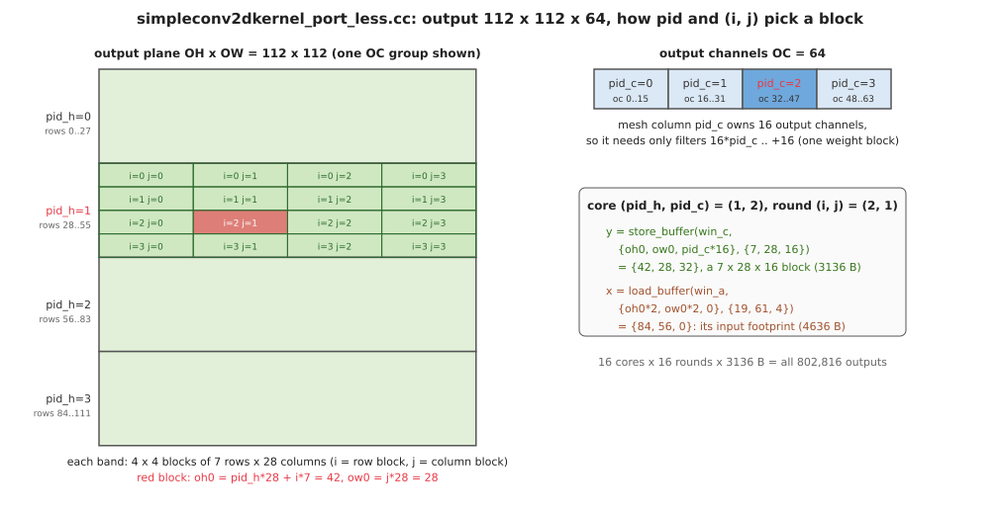
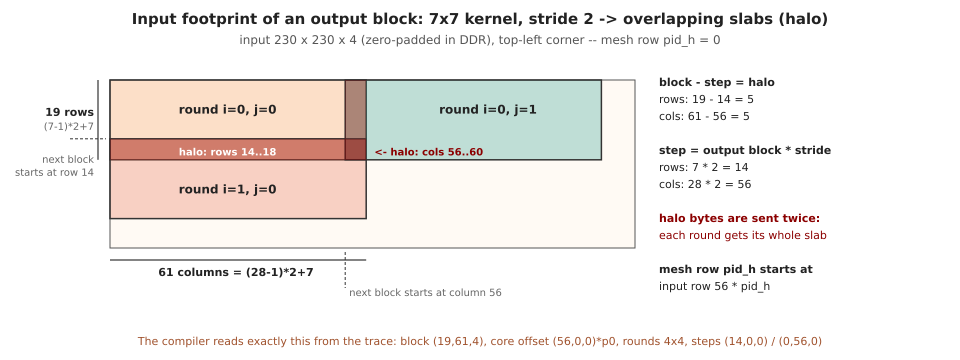
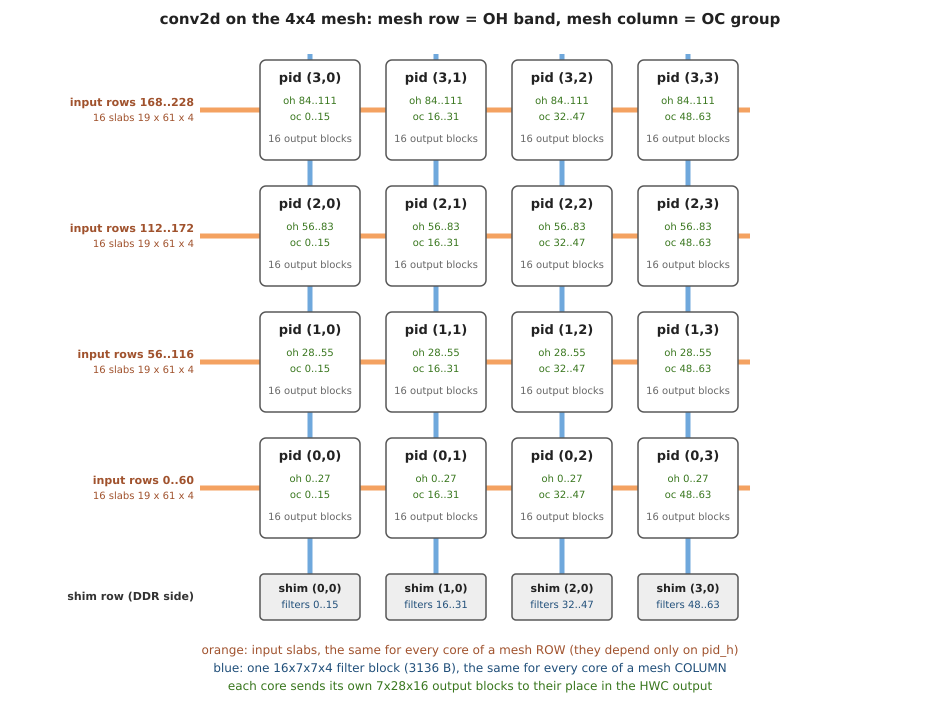

# Tutorial 2 -- Conv2d on a 4x4 tile mesh

Example: [`example/tileprogram/ccode/simpleconv2dkernel_port_less.cc`](../../example/tileprogram/ccode/simpleconv2dkernel_port_less.cc)
(59 lines, host included). Shared host helpers: `simpleconv2d_new_load.h`.

The ResNet stem convolution, int8:

```
input   224 x 224 x 3     -> stored pre-padded 230 x 230 x 4   (pad 3 each side, channel 4 = 0)
filter  64 x 7 x 7 x 4    (OHWI, channel 4 = 0)
output  112 x 112 x 64    (HWC)             7x7 kernel, stride 2
out[oh][ow][oc] = clamp_int8( sum over kh, kw, c of in[2oh+kh][2ow+kw][c] * w[oc][kh][kw][c] )
```

Read [tutorial 1](01_gemm_4x4.md) first: the ports, `program_id`,
`load_buffer` / `store_buffer` and `release` / `commit` work exactly as there.
This tutorial adds three things: tensors with 3 and 4 dimensions, choosing a
tiling for a convolution, and the **halo** -- input blocks that overlap.

## 1. The idea: split the output, then find what each block needs

Start from the output, as in the GEMM. 112 x 112 x 64 outputs on 16 cores:

- **mesh row `pid_h`** takes an output-row band of 112 / 4 = **28 rows**;
- **mesh column `pid_c`** takes **16 of the 64 output channels**, so it needs
  only filters `16 pid_c .. +16` -- one weight block of 16 x 7 x 7 x 4 =
  3136 bytes, loaded once;
- inside its band each core computes **4 x 4 blocks of 7 rows x 28 columns x
  16 channels** (3136 bytes each), one block per round.



A 7 x 28 output block of a 7x7 stride-2 conv reads an input **footprint** of

```
rows    (7 - 1) * 2 + 7 = 19        columns (28 - 1) * 2 + 7 = 61        channels 4
```

starting at input row `2 oh0`, column `2 ow0`. The next block down starts 7
output rows = 14 input rows lower, the next block right 28 columns = 56 input
columns further -- but each footprint is 19 rows / 61 columns tall / wide, so
**consecutive footprints overlap by 5**. That overlap is the halo; the DMA
simply sends those rows twice.



## 2. The kernel, line by line

```cpp
#include "simpleconv2d_new_load.h"
```
Host helpers: sizes (`M`, `N`, `K`, `INPUT_H_PAD` ...), `init_conv2d_test_data()`
and the CPU reference `scalar_conv2d()`. The kernel uses none of it.

```cpp
__global__ void conv2d_spatial(aie::port<input_window_int8 *, aie::IFM, aie::shape<230, 230, 4>> win_a,
                               aie::port<input_window_int8 *, aie::WEIGHTS, aie::shape<64, 7, 7, 4>> win_b,
                               aie::port<output_window_int8 *, aie::OFM, aie::shape<112, 112, 64>> win_c) {
```
Three ports, now with 3- and 4-D shapes. The shapes are the tensors **as they
lie in DDR**: the input is stored already zero-padded (230 = 224 + 2 x 3) and
channel-aligned (4 = 3 + one zero channel), the filter is OHWI, the output HWC.
Offsets and shapes in `load_buffer` follow the same dimension order.

```cpp
    const int KH = 7, KW = 7, S = 2, C = 4;         // 7x7 stride-2 conv, 4 (aligned) channels
    const int oh_t = 7, ow_t = 28, oc_t = 16;       // output block computed per round
```
The operator (kernel 7 x 7, stride 2, 4 channels) and the tiling (a 7 x 28 x 16
output block per round) are plain constants in the kernel.

```cpp
    const int ih_t = (oh_t - 1) * S + KH;           // 19: input footprint of one output block
    const int iw_t = (ow_t - 1) * S + KW;           // 61
```
The input block each output block needs (section 1). You compute it; the
compiler checks the side that breaks things: if the loops read past the block
you loaded, the trace stops with "data used without being loaded" at the
offending line. (Loading *more* than you read is legal -- the DMA just moves
bytes nobody uses -- so keep the footprint exact.)

```cpp
    const int oh_core = 112 / aie::num_programs(0); // 28 output rows per mesh row
```
`aie::num_programs(0)` = number of mesh rows (4), `num_programs(1)` = mesh
columns. Writing 112 / 4 this way keeps the kernel correct if the partition
changes.

```cpp
    const int pid_h = aie::program_id(0);           // mesh row: which OH band
    const int pid_c = aie::program_id(1);           // mesh col: which OC group
```
Mesh row = output-row band, mesh column = output-channel group.

```cpp
    const int8_t *w = aie::load_buffer(win_b, {pid_c * oc_t, 0, 0, 0}, {oc_t, KH, KW, C});
```
This core's filters: `{16, 7, 7, 4}` starting at filter `16 pid_c` -- 3136
bytes, loaded **once, before the loops**, and held until the end (`release`
is the last line). Element `w[((oc * 7 + kh) * 7 + kw) * 4 + c]`.

```cpp
    for (int i = 0; i < oh_core / oh_t; i++) {          // 4 row blocks
        for (int j = 0; j < 112 / ow_t; j++) {          // 4 column blocks
```
16 rounds per core: `i` walks the 4 row blocks of the band (outer), `j` the 4
column blocks (inner). The order matters -- it is the order the DMA will stream
the input and output blocks in. (Inner loop on the *outer* tensor dimension
is rejected with "swap the two loops", section 7.)

```cpp
            const int oh0 = pid_h * oh_core + i * oh_t; // output block origin
            const int ow0 = j * ow_t;
```
Top-left output pixel of this round's block, in tensor coordinates.

```cpp
            const int8_t *x = aie::load_buffer(win_a, {oh0 * S, ow0 * S, 0}, {ih_t, iw_t, C});
```
The input slab: 19 x 61 x 4 = 4636 bytes starting at input `(2 oh0, 2 ow0)`.
Element `x[(row * 61 + col) * 4 + c]`. Consecutive rounds' slabs overlap (the
halo); you do not handle that -- each round gets its full slab.

```cpp
            int8_t *y = aie::store_buffer(win_c, {oh0, ow0, pid_c * oc_t}, {oh_t, ow_t, oc_t});
```
The output block: 7 x 28 x 16 starting at `(oh0, ow0, 16 pid_c)`, element
`y[(oh * 28 + ow) * 16 + oc]`. Only 16 of the 64 channels of each pixel: the
DMA scatters the block into the HWC output with a 64-byte pixel pitch.

```cpp
            for (int oh = 0; oh < oh_t; oh++)
                for (int ow = 0; ow < ow_t; ow++)
                    for (int oc = 0; oc < oc_t; oc++) {
                        int acc = 0;
                        for (int kh = 0; kh < KH; kh++)
                            for (int kw = 0; kw < KW; kw++)
                                for (int c = 0; c < C; c++)
                                    acc += x[((oh * S + kh) * iw_t + ow * S + kw) * C + c] *
                                           w[((oc * KH + kh) * KW + kw) * C + c];
                        y[(oh * ow_t + ow) * oc_t + oc] = (int8_t)(acc > 127 ? 127 : acc < -128 ? -128 : acc);
                    }
```
The convolution of one block, written as plainly as possible: for every output
of the block, 7 x 7 x 4 = 196 multiply-accumulates over the slab and the
filters, then clamp to int8. Indices are **local to the blocks** -- the slab's
row `oh * 2 + kh` is input row `2 oh0 + 2 oh + kh`.

```cpp
            aie::release(win_a);
            aie::commit(win_c);
        }
    }
```
Slab done (the DMA may refill the buffer with the next slab); output block
done (the DMA sends it to DDR).

```cpp
    aie::release(win_b);
}
```
The filters are released after the last round: one weight block per core for
the whole launch.

## 3. The host, line by line

```cpp
int main() {
    aieSetDevice(0);
    aieArray device;
    aieMesh mesh = device.partition({3, 6, 0, 6}, HW_ROWS, HW_COLS);
```
As in tutorial 1: array columns 3..6, a 4 x 4 mesh.

```cpp
    const int in_n = INPUT_H_PAD * INPUT_W_PAD * INPUT_C_ALIGN, w_n = K * NUM_FILTERS, out_n = M * N;
```
Sizes in bytes: input 230 x 230 x 4 = 211,600; filters 196 x 64 = 12,544;
output 12,544 pixels x 64 channels = 802,816.

```cpp
    int8_t *input = (int8_t *)__Runtime_Alloc(in_n), *filter = (int8_t *)__Runtime_Alloc(w_n);
    int8_t *output = (int8_t *)__Runtime_Alloc(out_n), *ref = (int8_t *)__Runtime_Alloc(out_n);
    memset(output, 0, out_n);
```
DMA-reachable DDR buffers; `ref` receives the CPU result.

```cpp
    init_conv2d_test_data(input, filter); // simpleconv2d_new_load.h
```
Input values in [-4, 4] written into the **padded** layout (border and channel
4 stay 0), filters in {-1, 0, 1} (channel 4 = 0). Sums stay within +-588, so
the int8 clamp never hides a wrong sum.

```cpp
    XTime t0, t1;
    XTime_GetTime(&t0);
    conv2d_spatial<<<mesh>>>(input, filter, output, M, N, K);
    XTime_GetTime(&t1);
    printf("[BENCH] aie_wall_ms=%.3f\n", 1.0 * (t1 - t0) / COUNTS_PER_SECOND * 1000.0);
```
The launch (tutorial 1, section 3). The three buffers bind to the three ports
in order; `M, N, K` after them are accepted and ignored (kept from the older
API -- you can drop them).

```cpp
    scalar_conv2d(input, filter, ref);
    int bad = 0;
    for (int i = 0; i < out_n; i++)
        bad += output[i] != ref[i];
    printf("%s: %d mismatches out of %d\n", bad ? "FAIL" : "PASS", bad, out_n);
    return 0;
}
```
Bit-exact comparison against the CPU convolution.

## 4. How the pids land on the hardware



Same placement as the GEMM: pid `(pid_h, pid_c)` is array tile
`(3 + pid_c, 3 + pid_h)`.

- **input**: every core of mesh row `pid_h` needs the same 16 slabs (they
  depend on `pid_h`, `i`, `j`, not on `pid_c`) -> one stream per mesh row,
  broadcast along it; band `pid_h` starts at input row 56 `pid_h`;
- **weights**: every core of mesh column `pid_c` needs the same filter block ->
  one 3136-byte transfer per mesh column, broadcast down it;
- **output**: each core sends its 16 blocks to its own place in the HWC tensor.

## 5. What the compiler made of it

```
[KernelAnalysis] conv2d_spatial: traced on the 4x4 mesh
  win_a (IFM, tensor (230,230,4)): block (19,61,4), core offset (56,0,0)*p0 + (0,0,0)*p1, rounds 4x4 steps (14,0,0) / (0,56,0)
  win_b (WEIGHTS, tensor (64,7,7,4)): block (16,7,7,4), core offset (0,0,0,0)*p0 + (16,0,0,0)*p1, rounds 1x1 steps (0,0,0,0) / (0,0,0,0)
  win_c (OFM, tensor (112,112,64)): block (7,28,16), core offset (28,0,0)*p0 + (0,0,16)*p1, rounds 4x4 steps (7,0,0) / (0,28,0)
  routing plan on the 4x4 mesh (halo):
    win_a (IFM, row broadcast, 4x4 blocks/core): d1[230]=rows/4@56+i4x19@14 d2[230]=j4x61@56 d3[4]=whole
    win_b (WEIGHTS, col broadcast, 1x1 blocks/core): d1[64]=cols/4@16 d2[7]=whole d3[7]=whole d4[4]=whole
    win_c (OFM, gather, 4x4 blocks/core): d1[112]=rows/4@28+i4x7@7 d2[112]=j4x28@28 d3[64]=cols/4@16
  == spatial-halo conv 230x230x4 -> 112x112x64, kernel 7x7 stride 2 (cross-check: the conv derivation gives the same carriers)
  => routed: 3 ports on the 4x4 mesh, DMA carriers taken from the traced blocks
...
[TilingLinalg] conv2d_spatial: derived tiling matches the kernel analysis (rounds 16, OFM 3136 B, IFM 4636 B, WGT 3136 B)
```

- `win_a`: block 19 x 61 x 4, mesh rows 56 input rows apart, 4 x 4 rounds with
  steps 14 rows (`i`) and 56 columns (`j`). `d1[230]=rows/4@56+i4x19@14` is
  "dim 1 split over 4 mesh rows 56 apart, then 4 blocks of 19, step 14" -- the
  block is bigger than the step, which is exactly what `(halo)` refers to.
- `win_b`: one block per core (`rounds 1x1`), moving with `p1` only.
- The analysis also **recognizes** the blocks as a spatial-halo convolution
  and cross-checks them against the conv tiling model; the pipeline's own
  tiling must agree (`derived tiling matches the kernel analysis`), or the
  build stops instead of hanging on the board.

Core memory per core (`aieml.bcf`): slab ping + pong 2 x 4636 B, weights
2 x 3136 B, output ping + pong 2 x 3136 B = 21.8 KB of buffers, all
double-buffered by default. Tutorial 3 changes exactly that.

## 6. Run it

```bash
source script/aiehlc.sh --aie-version 5 --runtime-source-file ./example/tileprogram/ccode/simpleconv2dkernel_port_less.cc
python3 script/test/apppaltest.py -y --netload ./aout/main.elf
```

```
[BENCH] aie_wall_ms=93.845
PASS: 0 mismatches out of 802816
```

## 7. Try it (`./build/aiehlc-convtile trace <file.cc>`, no board needed)

- **A different block.** `ow_t = 14`: the report shows `block (19,33,4) ...
  rounds 4x8 steps (14,0,0) / (0,28,0)` -- 8 column blocks per row, a
  33-column slab (`(14 - 1) * 2 + 7`); the derived DMA follows.
- **Forget the halo.** `iw_t = ow_t * S` (56 columns): `ERROR: conv2d_spatial:
  the kernel accesses memory outside the block load_buffer/store_buffer
  returned at <file>:28 on core (0,0): data used without being loaded` -- line
  28 is the MAC line; the last output columns of a block need 5 more input
  columns.
- **Swap the loops** (`j` outer, `i` inner): `ERROR: ... win_a (IFM): blocks
  are visited with the outer loop on dim 1 and the inner loop on dim 0; the DMA
  streams the outer tensor dim in the outer loop -- swap the two loops`.

Next: [Tutorial 3 -- low-level scheduling options](03_conv2d_scheduling.md).
