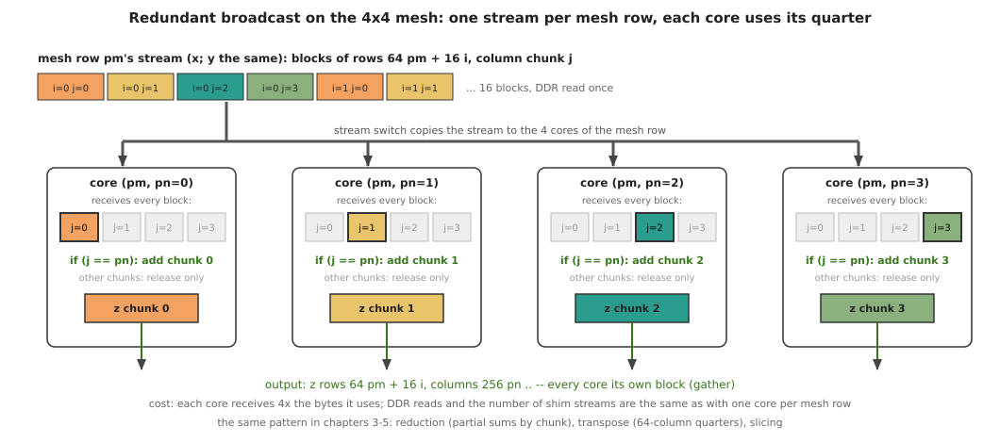

# 2. Elementwise: `z = saturate(x + y)` on the 4x4 mesh

> **Status (2026-11-15).** The kernel below passes the compiler's kernel
> analysis (section 3), but the pipeline after it still derives core windows
> from its GEMM tiling model and stops the build for this shape
> (`error: input: the core window is 64 elements x 1 round(s) per launch, but
> the kernel's blocks (#routing.kernel_block) are 4096 elements x 16`). Making
> the lowering follow every port's traced blocks is the pending compiler work;
> a runnable, board-measured example replaces this note when it lands.

## 1. The idea: broadcast a row's data, split the work by column

An elementwise op gives every core its **own** piece of every input. That is
exactly what the compiler cannot route on a 4x4 mesh today: an input block that
depends on both `program_id(0)` and `program_id(1)` is unique per core, and
inputs are only routed as broadcasts along a mesh row or a mesh column (section
4 shows the error).

So on 4x4 we use **redundant broadcast**:

- the input blocks depend on the **mesh row** `pm` only, so one stream carries
  them and the stream switch copies it to the row's 4 cores -- DDR is read once;
- each core uses only **its quarter** of what it receives: core `(pm, pn)`
  computes and stores column chunk `pn`.



## 2. The kernel, line by line

```cpp
#define OPS_R 256  // rows
#define OPS_C 1024 // columns (bytes)
```
Tensor sizes as `#define`s **in the `.cc`**: the kernel analysis compiles the
kernel with the object-like `#define`s of the source file itself, not with
those of included headers.

```cpp
__global__ void eltwise_add(aie::port<input_window_int8 *, aie::shape<OPS_R, OPS_C>> x,
                            aie::port<input_window_int8 *, aie::shape<OPS_R, OPS_C>> y,
                            aie::port<output_window_int8 *, aie::shape<OPS_R, OPS_C>> z) {
```
Three ports, no role tags (optional; the inputs become IFM, the output OFM).

```cpp
    const int tr = 16, tc = 256;                       // block: 16 rows x 256 columns (4 KB)
    const int rows = OPS_R / aie::num_programs(0);    // 64 rows per core
    const int pm = aie::program_id(0), pn = aie::program_id(1);
```
Mesh row `pm` owns rows `64 pm .. +63`, walked in 4 KB blocks.

```cpp
    for (int i = 0; i < rows / tr; i++)                // 4 row strips
        for (int j = 0; j < OPS_C / tc; j++) {         // 4 column chunks
            const int8_t *a = aie::load_buffer(x, {pm * rows + i * tr, j * tc}, {tr, tc});
            const int8_t *b = aie::load_buffer(y, {pm * rows + i * tr, j * tc}, {tr, tc});
```
Every core of the mesh row takes **every** block of its rows: the offsets use
`pm`, `i`, `j` -- not `pn` -- so the compiler routes x and y as row
broadcasts.

```cpp
            if (j == pn) { // this core's column chunk; the other three are only received
                int8_t *o = aie::store_buffer(z, {pm * rows + i * tr, j * tc}, {tr, tc});
                for (int e = 0; e < tr * tc; e++) {
                    const int v = a[e] + b[e];
                    o[e] = (int8_t)(v > 127 ? 127 : v < -128 ? -128 : v);
                }
                aie::commit(z);
            }
            aie::release(x);
            aie::release(y);
        }
```
Only the block whose column chunk is this core's (`j == pn`) is added and
stored; its output offset is `(64 pm + 16 i, 256 pn)` -- rows follow `pm`,
columns follow `pn`, one output block per core and strip. The other three
blocks are released unused. Every block must still be `release`d: the DMA
cannot refill a buffer the core still holds.

The host launches it on the full mesh, `device.partition({3, 6, 0, 6}, 4, 4)`.

## 3. What the compiler makes of it

```
  x (IFM, row broadcast, 4x4 blocks/core): d1[256]=rows/4@64+i4x16@16 d2[1024]=j4x256@256
  y (IFM, row broadcast, 4x4 blocks/core): d1[256]=rows/4@64+i4x16@16 d2[1024]=j4x256@256
  z (OFM, gather, 1x4 blocks/core): d1[256]=rows/4@64+j4x16@16 d2[1024]=cols/4@256
  => routed: 3 ports on the 4x4 mesh, DMA carriers taken from the traced blocks
```

- x and y: 16 blocks per core (`4x4`), broadcast along the mesh row.
- z: 4 blocks per core (`1x4`); dim 2 split over the mesh columns
  (`cols/4@256`) -- the `pn` in the output offset.

## 4. Why "redundant", and what it costs

The direct form -- core `(pm, pn)` loads only its own blocks -- is rejected:

```
ERROR: ... x (IFM): an input block that depends on both program ids is unique per core;
routing supports inputs broadcast along a mesh row (depends on program_id(0) only)
or a mesh col (program_id(1) only)
```

16 cores x 2 inputs would need 32 different streams; the partition's shim has
8 MM2S channels (4 columns x 2). Hardware could share streams between cores
(packet switching, or a MemTile splitting one stream); the compiler routes
inputs only as broadcasts so far.

The broadcast version costs:

| | 4x4 redundant broadcast | 4x1 (one core per mesh row, `simpleeltwise_add_4x1.cc`) |
|---|---|---|
| DDR reads | each block once | each block once |
| input streams | 8 (x and y, one per mesh row each) | 8 |
| bytes received per core | 4x what it uses | what it uses |
| compute per core | a quarter of the rows' columns | all of its rows |

The DDR traffic and the number of streams are the same; the 4x4 form spreads
the arithmetic over 4x more cores and pays in core input bandwidth and
buffers. Which one is faster depends on whether the cores (here: a scalar add
loop) or the shim streams are the bottleneck -- the board measurement will
settle it for this example once it builds.

## 5. What to take away

- An op whose cores each need a **different** piece of an input cannot be
  routed on 4x4 directly yet; **broadcast along the mesh row and split the
  work by `pn`** is the pattern that can.
- Elementwise ops do one operation per byte: they are bound by data movement
  far sooner than a GEMM, so count streams and bytes before counting cores.
- The cheapest elementwise op is one that never runs alone: **fuse** it into
  the kernel that produces the data (a bias add, activation or requantize in a
  GEMM / conv epilogue).

Next: [3. Reduction](../03_reduction/reduction.md).
