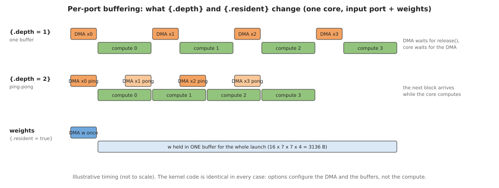

# Tutorial 3 -- Low-level scheduling: `{.depth}`, `{.resident}`, `{.tile}`

Example: [`example/tileprogram/ccode/simpleconv2dkernel_port_opts.cc`](../../example/tileprogram/ccode/simpleconv2dkernel_port_opts.cc)
-- [tutorial 2](02_conv2d_4x4.md)'s `simpleconv2dkernel_port_less.cc` with
**three changed lines**.

So far the kernel said *what* each core computes and *which blocks* it uses.
It did not say *how* the blocks move: how many buffers a port gets on the
core, and whether a block is sent once or with every round. The compiler
picked defaults. This tutorial shows how to choose, per port, without touching
the compute.

## 1. Two separate questions: compute and data movement

Every port is a stream of blocks between DDR and a core. For each port the
schedule has to answer:

1. **How many core buffers?** With one buffer, the DMA can only refill it after
   the core `release`s it, so the core waits for every transfer. With two
   (ping-pong), the DMA fills one while the core works on the other.
2. **How often is the block sent?** A block the core needs for the whole
   launch (the filters) should be sent once and kept, in one buffer -- not
   double-buffered, not re-sent.



The defaults: every port double-buffered (if the buffers fit), each block
streamed when its round comes. Options override that **per port**.

## 2. The options

They are the optional last argument of `load_buffer` / `store_buffer`, a
designated initializer:

```cpp
aie::load_buffer(port, offset, shape, {.depth = 2});
aie::load_buffer(port, offset, shape, {.resident = true});
aie::load_buffer(port, offset, shape, {.depth = 2, .tile = {8, 8}});   // 2-D blocks only
aie::store_buffer(port, offset, shape, {.depth = 2});                  // stores take only .depth
```

| Option | Meaning | Allowed when |
|---|---|---|
| `.depth = 1` / `2` | this port's core buffers: single / ping-pong | 1 or 2; at most that many blocks of the port held at once |
| `.resident = true` | one block per core, **sent once**, kept in **one** buffer for the whole launch | the kernel takes exactly one block of the port per core; not with `.depth = 2` |
| `.tile = {tr, tc}` | loads of 2-D blocks: the DMA delivers the block panel-major -- `tc`-wide column panels one after another -- so every `tr x tc` tile is contiguous (what a matrix unit wants) | divides the block; tile row and tensor row a multiple of 4 bytes |

Initializers go in the order `.reuse, .pad, .depth, .resident, .tile`, and
**every block of a port must pass the same options** -- they configure the
port's DMA, one setting per port. On the core they disappear: the compiler
drops the argument from the kernel code, so the compute is byte-for-byte the
same.

## 3. The change, line by line

The three lines that differ from `simpleconv2dkernel_port_less.cc`:

```cpp
    const int8_t *w = aie::load_buffer(win_b, {pid_c * oc_t, 0, 0, 0}, {oc_t, KH, KW, C}, {.resident = true});
```
The filters are one block per core, used in all 16 rounds: **resident**. One
3136-byte buffer instead of a ping-pong pair, sent once.

```cpp
            const int8_t *x = aie::load_buffer(win_a, {oh0 * S, ow0 * S, 0}, {ih_t, iw_t, C}, {.depth = 2});
            int8_t *y = aie::store_buffer(win_c, {oh0, ow0, pid_c * oc_t}, {oh_t, ow_t, oc_t}, {.depth = 2});
```
The input slab and the output block: **ping-pong**, so slab `k + 1` arrives
while block `k` is computed, and block `k - 1` drains while block `k` is
written. On this conv that is also what the compiler would choose (the halo
path is always ping-pong); writing it down makes the schedule explicit and
checked.

Everything else -- the loops, the MACs, the host -- is unchanged.

## 4. What changed in the build

The kernel analysis prints the options with each port:

```
win_a (IFM, ...): block (19,61,4), ... rounds 4x4 steps (14,0,0) / (0,56,0), options {.depth = 2}
win_b (WEIGHTS, ...): block (16,7,7,4), ... rounds 1x1 ..., options {.resident = true}
win_c (OFM, ...): block (7,28,16), ... rounds 4x4 steps (7,0,0) / (0,28,0), options {.depth = 2}
```

and the pipeline confirms it follows the resident port:

```
[KernelBlock] flowIdx=1 input follows the kernel's blocks: 1 x 3136 B per core, round stride 0/0 B
```

The generated code, `_less` vs `_opts`:

| | `simpleconv2dkernel_port_less.cc` | `simpleconv2dkernel_port_opts.cc` |
|---|---|---|
| weight window in `kernel.cc` | `window_init(..., buf_in_ping_1, ..., buf_in_pong_1, ...)` | `window_init(..., buf_in_ping_1, ..., buf_in_ping_1, ...)` -- one buffer |
| core buffers (`aieml.bcf`) | weights 0x78000 + 0x78c40, slab 0x79880 + 0x7aaa0, output 0x7bcc0 + 0x7c900 | weights 0x78000, slab 0x78c40 + 0x79e60, output 0x7b080 + 0x7bcc0 |
| buffer memory per core | 21,816 B | 18,680 B |
| weight S2MM BDs per core (`host.cc`) | 2, chained ping -> pong | 1 |
| `routing.cc` | -- | identical |

Same data movement on the wire (the weights were already one transfer per
mesh column), one buffer and one buffer descriptor less per core.

## 5. Measured

```
simpleconv2dkernel_port_less.cc   [BENCH] aie_wall_ms=93.845   PASS: 0 mismatches out of 802816
simpleconv2dkernel_port_opts.cc   [BENCH] aie_wall_ms=85.855   PASS: 0 mismatches out of 802816
```

8 ms (9 %) from one option, with identical compute -- because a launch here is
dominated by **configuration**, not by the MACs. The port buffers are part of
the kernel's data image, which every launch writes into all 16 cores over the
configuration bus at roughly 0.4 us per 32-bit word
(`doc/performance/register_write_cost.md`). One 3136-byte buffer less on 16
cores is 12,544 words, about 4.7 ms by that rate, plus the buffer descriptor
and lock writes that went with it. Memory freed on the core is also memory a
bigger tile can use.

## 6. The rules, as the compiler enforces them

Try each on `simpleconv2dkernel_port_opts.cc` with
`./build/aiehlc-convtile trace <file.cc>`:

| Change | Result |
|---|---|
| slab `{.depth = 1}` | `ERROR: ... win_a (IFM): {.depth = 1} is not supported on a spatial-halo (conv) kernel yet -- its window lowering is ping-pong; use {.depth = 2}, or {.resident = true} for a block taken once` |
| slab `{.resident = true}` | `ERROR: ... {.resident = true}, but the kernel takes 16 blocks of this port per core; a resident block is loaded once (outside the loop) and held for the whole launch` |
| slab `{.depth = 2, .tile = {1, 4}}` | `ERROR: ... {.tile} re-lays out a 2-D block; this port's blocks have 3 dims` |
| slab `{.depth = j == 0 ? 1 : 2}` | `ERROR: ... block 1 on core (0,0) passes different {.depth / .resident / .tile} options than block 0 (they configure the port's DMA, one setting per port)` |

Options never change what is computed, so a wrong option is a build error,
never a wrong answer.

## 7. Where the other options pay off: the GEMM path

On a GEMM-style kernel (`fullconnect_auto`, no halo -- tutorial 1) the
defaults are less suited than on this conv, and the options do more:

- the GEMM schedule **re-sends B with every M round**; `{.resident = true}` on
  B sends it once and keeps it;
- `{.depth}` sets one port's buffering on its own (the example ping-pongs its
  A strips while B is resident; `{.depth = 1}` would single-buffer a port that
  must make room for others);
- `{.tile = {8, 8}}` makes the DMA deliver A in 8 x 8 tiles, the operand layout
  of `aie::mmul<8,8,8>`, so the core never re-arranges A.

`example/tileprogram/ccode/simplegemm_dataflow.cc` uses all three
(256 x 256 x 256 x 8 panels per launch, GOLDEN PASS 524,288 / 524,288,
79.6 ms on the board). Design notes: `doc/design/trace_to_routing.md`,
section "Dataflow options".

Next: [Tutorial 4 -- vector instructions + scheduling](04_conv2d_vector_scheduling.md).
