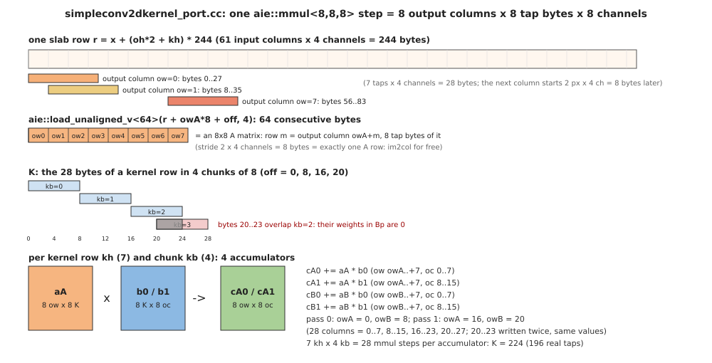

# 6.4 Vector instructions + scheduling on the conv2d

Examples:

- [`simpleconv2dkernel_port.cc`](../../../example/tileprogram/ccode/simpleconv2dkernel_port.cc)
  -- the conv of [1b](../01_contraction/conv2d.md) computed with `aie::mmul`;
- [`simpleconv2dkernel_port_opts.cc`](../../../example/tileprogram/ccode/simpleconv2dkernel_port_opts.cc)
  -- the scheduling options of [6.3](3_conv_scheduling.md);
- [`simpleconv2dkernel_port_vec_opts.cc`](../../../example/tileprogram/ccode/simpleconv2dkernel_port_vec_opts.cc)
  -- both together, with the output schedule a fast kernel needs and a
  golden-checking host. **This is the file to start from.**

## The whole program

The whole program: vector compute, per-port scheduling options, the output schedule, and a
host that de-tiles and golden-checks the result.

<!-- code: example/tileprogram/ccode/simpleconv2dkernel_port_vec_opts.cc -->
```cpp
#include "simpleconv2d_new_load.h"
// simpleconv2dkernel_port.cc (aie::mmul<8,8,8> compute) + the per-port schedule
// options of simpleconv2dkernel_port_opts.cc + a golden-checking host.
// Walkthrough: tutorial/aieprogram/06_gemm_optimization/4_conv_vector_scheduling.md
//
// output_tile_major: each core's 16 output blocks land back to back in DDR
// ([mesh row][mesh col][round][7][28][16]) through ONE shim BD per core. The
// dense HWC layout needs the host to re-program the shim S2MM BDs between
// height slabs, and this kernel is fast enough to send the next block while
// they are rewritten: whole blocks then land at another round's address.
#pragma output_tile_major
__global__ void conv2d_spatial(aie::port<input_window_int8 *, aie::IFM, aie::shape<230, 230, 4>> win_a,
                               aie::port<input_window_int8 *, aie::WEIGHTS, aie::shape<64, 7, 7, 4>> win_b,
                               aie::port<output_window_int8 *, aie::OFM, aie::shape<112, 112, 64>> win_c) {
    const int KH = 7, KW = 7, S = 2, C = 4;         // 7x7 stride-2 conv, 4 (aligned) channels
    const int oh_t = 7, ow_t = 28, oc_t = 16;       // output block computed per round
    const int ih_t = (oh_t - 1) * S + KH;           // 19: input footprint of one output block
    const int iw_t = (ow_t - 1) * S + KW;           // 61
    const int oh_core = 112 / aie::num_programs(0); // 28 output rows per mesh row
    const int TAPS = KH * KW * C;                   // 196 bytes per filter
    const int ROW = iw_t * C;                       // 244 bytes per slab row
    const int pid_h = aie::program_id(0);           // mesh row: which OH band
    const int pid_c = aie::program_id(1);           // mesh col: which OC group
    using MM = aie::mmul<8, 8, 8, int8_t, int8_t>;
    aie::set_saturation(aie::saturation_mode::saturate); // int8 results clamp like the scalar reference

    // Weights: one block per core, sent once, ONE buffer -- packed into mmul B order right away.
    const int8_t *w = aie::load_buffer(win_b, {pid_c * oc_t, 0, 0, 0}, {oc_t, KH, KW, C}, {.resident = true});
    alignas(64) int8_t Bp[7 * 4 * 2 * 64]; // [kh][kb][nb][k 8][n 8]
    for (int kh = 0; kh < KH; kh++)
        for (int kb = 0; kb < 4; kb++)
            for (int nb = 0; nb < 2; nb++)
                for (int k = 0; k < 8; k++)
                    for (int n = 0; n < 8; n++) {
                        const int byte = kb < 3 ? kb * 8 + k : 20 + k; // tap byte within kernel row kh
                        const bool live = kb < 3 || k >= 4;            // bytes 20..23 already in kb 2
                        Bp[(((kh * 4 + kb) * 2 + nb) * 8 + k) * 8 + n] =
                            live ? w[(nb * 8 + n) * TAPS + kh * KW * C + byte] : (int8_t)0;
                    }
    aie::release(win_b);
    const aie::accum<acc32, 64> zero = aie::zeros<acc32, 64>();

    for (int i = 0; i < oh_core / oh_t; i++) {          // 4 row blocks
        for (int j = 0; j < 112 / ow_t; j++) {          // 4 column blocks
            const int oh0 = pid_h * oh_core + i * oh_t; // output block origin
            const int ow0 = j * ow_t;
            // Ping-pong: the DMA fills the next slab / drains the last block while the core computes.
            const int8_t *x = aie::load_buffer(win_a, {oh0 * S, ow0 * S, 0}, {ih_t, iw_t, C}, {.depth = 2});
            int8_t *y = aie::store_buffer(win_c, {oh0, ow0, pid_c * oc_t}, {oh_t, ow_t, oc_t}, {.depth = 2});
            for (int oh = 0; oh < oh_t; oh++) {
                for (int pass = 0; pass < 2; pass++) {
                    const int owA = pass * 16, owB = pass * 16 + (pass ? 4 : 8); // 0,8 then 16,20
                    MM cA0(zero), cA1(zero), cB0(zero), cB1(zero);
                    for (int kh = 0; kh < KH; kh++)
                        chess_prepare_for_pipelining chess_loop_range(7, 7) {
                            const int8_t *r = x + (oh * S + kh) * ROW;
                            const int8_t *bk = Bp + kh * 4 * 2 * 64;
                            for (int kb = 0; kb < 4; kb++)
                                chess_unroll_loop() {
                                    const int off = kb < 3 ? kb * 8 : 20;
                                    const aie::vector<int8_t, 64> aA = aie::load_unaligned_v<64>(r + owA * 8 + off, 4);
                                    const aie::vector<int8_t, 64> aB = aie::load_unaligned_v<64>(r + owB * 8 + off, 4);
                                    const aie::vector<int8_t, 64> b0 = aie::load_v<64>(bk + (kb * 2 + 0) * 64);
                                    const aie::vector<int8_t, 64> b1 = aie::load_v<64>(bk + (kb * 2 + 1) * 64);
                                    cA0.mac(aA, b0);
                                    cA1.mac(aA, b1);
                                    cB0.mac(aB, b0);
                                    cB1.mac(aB, b1);
                                }
                        }
                    // 8 columns x 16 channels = 128 contiguous output bytes:
                    // interleave the two N-blocks 8 channels at a time.
                    const int owc[2] = {owA, owB};
                    const MM *acc[2][2] = {{&cA0, &cA1}, {&cB0, &cB1}};
                    for (int m = 0; m < 2; m++) {
                        const auto z =
                            aie::interleave_zip(acc[m][0]->to_vector<int8_t>(0), acc[m][1]->to_vector<int8_t>(0), 8);
                        int8_t *o = y + (oh * ow_t + owc[m]) * oc_t; // 32-byte aligned (window base is)
                        aie::store_v(o, z.first.extract<32>(0));
                        aie::store_v(o + 32, z.first.extract<32>(1));
                        aie::store_v(o + 64, z.second.extract<32>(0));
                        aie::store_v(o + 96, z.second.extract<32>(1));
                    }
                }
            }
            aie::release(win_a);
            aie::commit(win_c);
        }
    }
}
// HOST: same data as simpleconv2dkernel_port_less.cc, then a golden check vs scalar_conv2d().
int main() {
    aieSetDevice(0);
    aieArray device;
    aieMesh mesh = device.partition({3, 6, 0, 6}, HW_ROWS, HW_COLS);
    const int in_n = INPUT_H_PAD * INPUT_W_PAD * INPUT_C_ALIGN, w_n = K * NUM_FILTERS, out_n = M * N;
    int8_t *input = (int8_t *)__Runtime_Alloc(in_n), *filter = (int8_t *)__Runtime_Alloc(w_n);
    int8_t *tiles = (int8_t *)__Runtime_Alloc(out_n); // what the AIE writes (tile-major)
    int8_t *output = (int8_t *)__Runtime_Alloc(out_n), *ref = (int8_t *)__Runtime_Alloc(out_n);
    memset(tiles, 0, out_n);
    init_conv2d_test_data(input, filter); // simpleconv2d_new_load.h
    XTime t0, t1;
    XTime_GetTime(&t0);
    conv2d_spatial<<<mesh>>>(input, filter, tiles, M, N, K);
    XTime_GetTime(&t1);
    printf("[BENCH] aie_wall_ms=%.3f\n", 1.0 * (t1 - t0) / COUNTS_PER_SECOND * 1000.0);
    // De-tile: core (r, c), round (i, j) holds output rows r*28 + i*7.., columns j*28.., channels c*16..
    const int8_t *src = tiles;
    for (int r = 0; r < HW_ROWS; r++)
        for (int c = 0; c < HW_COLS; c++)
            for (int i = 0; i < 4; i++)
                for (int j = 0; j < 4; j++)
                    for (int y = 0; y < 7; y++)
                        for (int x = 0; x < 28; x++, src += 16)
                            memcpy(&output[((r * 28 + i * 7 + y) * OUTPUT_W + j * 28 + x) * NUM_FILTERS + c * 16], src, 16);
    scalar_conv2d(input, filter, ref);
    int bad = 0;
    for (int i = 0; i < out_n; i++)
        bad += output[i] != ref[i];
    printf("%s: %d mismatches out of %d\n", bad ? "FAIL" : "PASS", bad, out_n);
    return 0;
}
```
<!-- /code -->

The ports, blocks, loops and host stay exactly as in 1b and 6.3; only
the inner computation changes -- and then, because the kernel got fast, one
part of the schedule has to change too.

## 1. Why: the scalar MAC loop

The scalar kernel spends about 650 cycles per output: 196 multiply-accumulates
issued one at a time, plus addressing (`doc/design/op_mapping_programming_model.md`
section 7: 89 instruction bundles per 28 MACs). The AIE core has a matrix unit:
`aie::mmul<8, 8, 8, int8_t, int8_t>` multiplies an 8 x 8 int8 matrix by an
8 x 8 one into an 8 x 8 int32 accumulator -- 512 MACs in one `VMAC`
instruction. The work is to present the convolution as such 8 x 8 x 8 products.

## 2. The convolution as matrix products

```
C [8 output columns x 8 channels]  +=  A [8 output columns x 8 K]  x  B [8 K x 8 channels]
```

- **M = output columns.** One output row of the block has 28 columns.
- **N = output channels.** 16 per core = 2 N-blocks of 8.
- **K = the 7 x 7 x 4 = 196 taps**, walked one kernel row `kh` at a time: a
  kernel row of one output is 7 taps x 4 channels = **28 bytes**.

The key observation: with stride 2 and 4 channels, output column `ow` starts
`2 x 4 = 8` bytes after column `ow - 1` in the slab row, and its 28 bytes are
contiguous. So the A matrix for 8 consecutive output columns and 8 consecutive
tap bytes is simply **64 consecutive bytes** of the slab row: row `m` of A =
bytes `8m .. 8m + 7` = output column `m`'s next 8 tap bytes. No im2col copy --
one unaligned vector load.

The 28 bytes of a kernel row become 4 K-blocks of 8: bytes 0-7, 8-15, 16-23
and **20-27**. The last block starts 4 bytes early so it never reads past the
end of the slab row; its first 4 rows are multiplied by zero weights, so bytes
20-23 are not counted twice.



## 3. The vector kernel, line by line

Lines identical to 1b (ports, block constants, `program_id`, the `i` /
`j` loops, `load_buffer` / `store_buffer`, `release` / `commit`) are not
repeated. From `simpleconv2dkernel_port_vec_opts.cc`:

```cpp
    const int TAPS = KH * KW * C;                   // 196 bytes per filter
    const int ROW = iw_t * C;                       // 244 bytes per slab row
```
Byte strides: one filter in the weight block, one row of the 19 x 61 x 4 slab.

```cpp
    using MM = aie::mmul<8, 8, 8, int8_t, int8_t>;
    aie::set_saturation(aie::saturation_mode::saturate); // int8 results clamp like the scalar reference
```
The matrix-multiply type (M = K = N = 8, int8 operands, int32 accumulation),
and saturation when the int32 accumulator is narrowed to int8 -- the vector
equivalent of the scalar `acc > 127 ? 127 : ...`.

```cpp
    const int8_t *w = aie::load_buffer(win_b, {pid_c * oc_t, 0, 0, 0}, {oc_t, KH, KW, C}, {.resident = true});
```
The filters, **resident** (6.3): one 3136-byte block per core, one
buffer, sent once.

```cpp
    alignas(64) int8_t Bp[7 * 4 * 2 * 64]; // [kh][kb][nb][k 8][n 8]
    for (int kh = 0; kh < KH; kh++)
        for (int kb = 0; kb < 4; kb++)
            for (int nb = 0; nb < 2; nb++)
                for (int k = 0; k < 8; k++)
                    for (int n = 0; n < 8; n++) {
                        const int byte = kb < 3 ? kb * 8 + k : 20 + k; // tap byte within kernel row kh
                        const bool live = kb < 3 || k >= 4;            // bytes 20..23 already in kb 2
                        Bp[(((kh * 4 + kb) * 2 + nb) * 8 + k) * 8 + n] =
                            live ? w[(nb * 8 + n) * TAPS + kh * KW * C + byte] : (int8_t)0;
                    }
```
**Pack the filters into B tiles once per launch.** `mmul` wants B as an 8 x 8
row-major matrix, `B[k][n]` = tap byte `k` of filter `n`. The weight block is
`w[filter][kh][kw][c]`, i.e. filter-major. So for every kernel row `kh`, K-block
`kb` and N-block `nb` this builds one 64-byte tile: row `k` = tap byte
`kb*8 + k` (or `20 + k` for the shifted last block) of filters `nb*8 .. nb*8+7`.
Rows 0-3 of the last block are zero (`live`), which cancels the 4 overlapping
bytes. 7 x 4 x 2 tiles x 64 B = 3584 bytes, 64-byte aligned for `aie::load_v`.

```cpp
    aie::release(win_b);
    const aie::accum<acc32, 64> zero = aie::zeros<acc32, 64>();
```
The weights are now in `Bp`, so the weight window can be released right
away. `zero` initializes the accumulators.

```cpp
    for (int i = 0; i < oh_core / oh_t; i++) {          // 4 row blocks
        for (int j = 0; j < 112 / ow_t; j++) {          // 4 column blocks
            ...
            const int8_t *x = aie::load_buffer(win_a, {oh0 * S, ow0 * S, 0}, {ih_t, iw_t, C}, {.depth = 2});
            int8_t *y = aie::store_buffer(win_c, {oh0, ow0, pid_c * oc_t}, {oh_t, ow_t, oc_t}, {.depth = 2});
```
Unchanged blocks, ping-pong slab and output (6.3).

```cpp
            for (int oh = 0; oh < oh_t; oh++) {
                for (int pass = 0; pass < 2; pass++) {
                    const int owA = pass * 16, owB = pass * 16 + (pass ? 4 : 8); // 0,8 then 16,20
                    MM cA0(zero), cA1(zero), cB0(zero), cB1(zero);
```
For each of the 7 output rows, the 28 columns are covered by four M-blocks of
8: columns 0-7 and 8-15 (pass 0), 16-23 and 20-27 (pass 1). The last block
overlaps the third by 4 columns and simply rewrites them with the same values
-- cheaper than a 4-wide special case. Each pass keeps **four accumulators**:
two M-blocks (`A`, `B`) x two N-blocks (`0` = channels 0-7, `1` = 8-15). Four
independent accumulators also let the compiler keep the matrix unit busy.

```cpp
                    for (int kh = 0; kh < KH; kh++)
                        chess_prepare_for_pipelining chess_loop_range(7, 7) {
                            const int8_t *r = x + (oh * S + kh) * ROW;
                            const int8_t *bk = Bp + kh * 4 * 2 * 64;
```
Loop over the 7 kernel rows. `chess_prepare_for_pipelining` asks the AIE
compiler to software-pipeline the loop (overlap the loads of iteration `kh+1`
with the MACs of `kh`); `chess_loop_range(7, 7)` tells it the trip count is
exactly 7. `r` = the slab row this kernel row reads, `bk` = its packed filters.

```cpp
                            for (int kb = 0; kb < 4; kb++)
                                chess_unroll_loop() {
                                    const int off = kb < 3 ? kb * 8 : 20;
                                    const aie::vector<int8_t, 64> aA = aie::load_unaligned_v<64>(r + owA * 8 + off, 4);
                                    const aie::vector<int8_t, 64> aB = aie::load_unaligned_v<64>(r + owB * 8 + off, 4);
```
The four K-blocks, fully unrolled. `aA` = the A tile of M-block `owA`: 64 bytes
starting at column `owA`'s first byte plus the K offset -- rows are output
columns, as in section 2. `load_unaligned_v<64>(p, 4)` loads 64 bytes from an
address that is only guaranteed to be 4-byte aligned (slab rows are 244
bytes, not a multiple of 8).

```cpp
                                    const aie::vector<int8_t, 64> b0 = aie::load_v<64>(bk + (kb * 2 + 0) * 64);
                                    const aie::vector<int8_t, 64> b1 = aie::load_v<64>(bk + (kb * 2 + 1) * 64);
                                    cA0.mac(aA, b0);
                                    cA1.mac(aA, b1);
                                    cB0.mac(aB, b0);
                                    cB1.mac(aB, b1);
                                }
                        }
```
The two B tiles of this `kh, kb` (aligned loads from `Bp`), then four
8 x 8 x 8 multiply-accumulates: every loaded A and B tile is used twice. Per
pass: 7 x 4 x 4 = 112 `VMAC`s = 57,344 MACs. (The design doc reports the kh loop
pipelining at one `VMAC` per instruction bundle.)

```cpp
                    const int owc[2] = {owA, owB};
                    const MM *acc[2][2] = {{&cA0, &cA1}, {&cB0, &cB1}};
                    for (int m = 0; m < 2; m++) {
                        const auto z =
                            aie::interleave_zip(acc[m][0]->to_vector<int8_t>(0), acc[m][1]->to_vector<int8_t>(0), 8);
                        int8_t *o = y + (oh * ow_t + owc[m]) * oc_t; // 32-byte aligned (window base is)
                        aie::store_v(o, z.first.extract<32>(0));
                        aie::store_v(o + 32, z.first.extract<32>(1));
                        aie::store_v(o + 64, z.second.extract<32>(0));
                        aie::store_v(o + 96, z.second.extract<32>(1));
                    }
```
Write back. `to_vector<int8_t>(0)` narrows the int32 accumulator to int8
(shift 0, saturating). The output block is `[oh][ow][16 channels]`, so 8
columns x 16 channels = **128 contiguous bytes**, each column = channels 0-7
from the `0` accumulator then 8-15 from the `1` accumulator.
`interleave_zip(..., 8)` produces exactly that order, 8 bytes from each in
turn; four 32-byte stores write it (output windows are 32-byte aligned, so 64
byte stores are not allowed).

## 4. Check it on x86 first

The compiler's kernel analysis runs this vector code on x86 through an
emulation of the AIE API (`src/mlir/runtime/aie_api_x86emu.h`), so the block
checks of chapter 1 apply, plus vector checks: a 64-byte load that runs
past the block, or an aligned `load_v` on a 32-byte-aligned window, is a build
error at its line. The whole generated kernel can also be emulated against the
CPU reference:

```bash
source script/aiehlc.sh --aie-version 5 --runtime-source-file ./example/tileprogram/ccode/simpleconv2dkernel_port_vec_opts.cc
bash example/tileprogram/ccode/simpleconv2ddebug/emu_conv2d_spatial.sh aout/worklocal
#   BLKE=0 mismatches=0/802816 -> PASS
```

That proves the **arithmetic and the blocks**. It cannot prove the **timing**
-- which is the next section.

## 5. A schedule problem that only a fast kernel has

Take `simpleconv2dkernel_port.cc` (the same vector kernel, without options),
give it the golden-checking host, and run it on the board:

```
[BENCH] aie_wall_ms=64.727
FAIL: 483593 mismatches out of 802816          (x86 emulation of the same build: 0 mismatches)
```

The wrong values are not random: for the failing core and round, every output
equals the correct value of the **same position in another round's block**
(core (0,3), round (0,0) held round (1,0)'s results, 24 / 24 sampled outputs).
Whole blocks land at another round's address.

The cause is in the generated `host.cc`. The output is dense HWC: each core
writes its 4 x 4 blocks into the image, a 2-D walk over (row blocks, column
blocks) per core. A shim buffer descriptor has only one iteration dimension,
so the column blocks are folded into the descriptor and the **row blocks become
a host loop that re-programs the shim S2MM descriptors between them**:

```cpp
  for (size_t v406 = v9; v406 < v10; v406 += v11) {     // per row block
    ... /* Create IO: channel_id=0, bd_id=2, tile=(3,0), direction=S2MM */ ...
```

The scalar kernel needs about 2 ms per round (~650 cycles x 3136 outputs
at ~1 GHz), so the host always finishes re-programming before the next block
arrives. The vector kernel is fast enough
to send the next row block **while the descriptors are being rewritten**, and
that block lands at the old address. The same failure appears with or without
the tutorial-3 options -- it is the output schedule, not the buffers.

**The fix is a scheduling choice: `#pragma output_tile_major`.**

```cpp
#pragma output_tile_major
```

Each core's 16 output blocks are written **back to back** in DDR instead of
into the image: layout `[mesh row][mesh col][round][7][28][16]`, one shim
descriptor per core configured once, no host loop. The build log confirms it:

```
[aiehlc] Detected #pragma output_tile_major
[OutputTileDescriptor] output_tile_major: roundBytes=3136 rounds/core=16 perTileStride=50176
```

The kernel does not change -- `store_buffer` still names the block in image
coordinates. The host receives tiles and puts them into the image:

```cpp
    int8_t *tiles = (int8_t *)__Runtime_Alloc(out_n); // what the AIE writes (tile-major)
    ...
    conv2d_spatial<<<mesh>>>(input, filter, tiles, M, N, K);
    ...
    // De-tile: core (r, c), round (i, j) holds output rows r*28 + i*7.., columns j*28.., channels c*16..
    const int8_t *src = tiles;
    for (int r = 0; r < HW_ROWS; r++)
        for (int c = 0; c < HW_COLS; c++)
            for (int i = 0; i < 4; i++)
                for (int j = 0; j < 4; j++)
                    for (int y = 0; y < 7; y++)
                        for (int x = 0; x < 28; x++, src += 16)
                            memcpy(&output[((r * 28 + i * 7 + y) * OUTPUT_W + j * 28 + x) * NUM_FILTERS + c * 16], src, 16);
```

The order of the loops is the tile-major order: mesh row, mesh column, round
(`i` outer, `j` inner -- the kernel's loop order), then the 7 x 28 pixels of
the block, 16 channels each.

## 6. Results

All on the board (palmyra), same data, golden-checked against `scalar_conv2d`:

| Build | Launch | Result |
|---|---|---|
| scalar (`_less`, 1b) | 93.8 ms | PASS |
| scalar + `.resident` / `.depth` (`_opts`, 6.3) | 85.8 ms | PASS |
| vector, dense output (`simpleconv2dkernel_port.cc` + check) | 64.7 ms | FAIL, 483,593 -- output race |
| vector + `.resident` / `.depth`, dense output | 56.8 ms | FAIL, 545,488 -- output race |
| **vector + `.resident` / `.depth` + `output_tile_major`** (`_vec_opts`) | **56.4 ms** | **PASS, 3 / 3 runs** |

What each step bought:

- **vector instead of scalar**: ~29 ms -- the compute part of the launch;
- **`.resident` weights**: ~8 ms, on both the scalar and the vector kernel
  (one buffer less per core to configure, 6.3);
- **`output_tile_major`**: correctness. A fast kernel is a new schedule, and
  a schedule that was safe for a slow one may not be.

The remaining ~56 ms is mostly launch configuration (kernel load and buffer
descriptors over the configuration bus), not MACs. The next step is moving
that configuration onto the control-packet plane and reusing it across
launches -- `src/aietensorop/conv2dstem/conv2dstem.cc` runs this same stem
convolution in **185 us per launch** that way (see `CLAUDE.md` and
`doc/performance/conv2dstem_perf_review.md`).

## 7. Checklist for your own vector kernel

1. Write the scalar kernel first and get `PASS` on the board (1b).
2. Choose M / N / K so an A tile is one contiguous load where you can (here:
   stride x channels = 8 bytes = one K-block).
3. Pack the operand that is reused (filters) once, outside the loops.
4. Emulate on x86 (`emu_conv2d_spatial.sh`): arithmetic and blocks.
5. **Run the golden check on the board** -- x86 cannot see DMA timing. If whole
   blocks are wrong only once the kernel is fast, look at the output schedule
   (`output_tile_major`).
6. Then tune the data movement with `.resident` / `.depth` (6.3).
