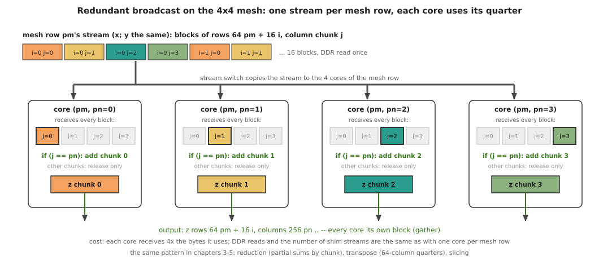

# 7.1 Special data flow: broadcast (row and column)

> **Data flow: broadcast.** One block read once from DDR and delivered to
> several cores. On the 4x4 GEMM mesh, A goes to every core of a mesh **row**
> and B to every core of a mesh **column**. This chapter follows that one
> pattern from the kernel line to the stream switch, the BDs, the buffer
> lifetimes and the cost.

> **Status.** Doc only: no new example. The program is the chapter 1a GEMM
> (`example/tileprogram/ccode/simplegemm_kernel_port.cc`, board PASS).
> All refs are checked against base `43fcb8f` by script/check_refs.sh (added with this chapter).

## The whole program

The whole program -- kernel and host, 4x4 mesh (the listing is kept in sync with
the source by `tutorial/aieprogram/sync_code.py`).

<!-- code: example/tileprogram/ccode/simplegemm_kernel_port.cc -->
```cpp
/******************************************************************************
 * Copyright (C) 2026 Advanced Micro Devices, Inc. All Rights Reserved.
 * SPDX-License-Identifier: Apache-2.0
 * Kernel-only GEMM: the DMA is derived from the kernel.
 *   C[64, 64] = A[64, 256] x B[64, 256]^T, int8, on the 4x4 mesh
 ******************************************************************************/
#include "simplegemm_load.h"
__global__ void gemm(aie::port<input_window_int8 *, aie::IFM, aie::shape<64, 256>> a,
                     aie::port<input_window_int8 *, aie::WEIGHTS, aie::shape<64, 256>> b,
                     aie::port<output_window_int8 *, aie::OFM, aie::shape<64, 64>> c) {
    const int tm = 16, tn = 16, tk = 64; // C block per core, K chunk per round
    const int pm = aie::program_id(0);   // mesh row: which 16 rows of C
    const int pn = aie::program_id(1);   // mesh col: which 16 columns of C
    int8_t *y = aie::store_buffer(c, {pm * tm, pn * tn}, {tm, tn});
    int acc[tm * tn];
    for (int i = 0; i < tm * tn; i++)
        acc[i] = 0;
    for (int j = 0; j < 256 / tk; j++) { // K chunks
        const int8_t *x = aie::load_buffer(a, {pm * tm, j * tk}, {tm, tk});
        const int8_t *w = aie::load_buffer(b, {pn * tn, j * tk}, {tn, tk});
        for (int m = 0; m < tm; m++)
            for (int n = 0; n < tn; n++) {
                int s = 0;
                for (int k = 0; k < tk; k++)
                    s += x[m * tk + k] * w[n * tk + k];
                acc[m * tn + n] += s;
            }
        aie::release(a);
        aie::release(b);
    }
    for (int i = 0; i < tm * tn; i++)
        y[i] = (int8_t)acc[i];
    aie::commit(c);
}

int main() {
    printf("=== Kernel-only GEMM (DMA from the kernel's blocks) on AIE %dx%d ===\n", HW_ROWS, HW_COLS);
    printf("    C[%dx%d] = A[%dx%d] x B^T[%dx%d], int8\n", GEMM_M, GEMM_N, GEMM_M, GEMM_K, GEMM_K, GEMM_N);
    aieSetDevice(0);
    aieArray device;
    aieMesh mesh = device.partition({3, 6, 0, 6}, HW_ROWS, HW_COLS);
    int8_t *A = (int8_t *)__Runtime_Alloc(GEMM_M * GEMM_K);
    int8_t *B = (int8_t *)__Runtime_Alloc(GEMM_N * GEMM_K);
    int8_t *C = (int8_t *)__Runtime_Alloc(GEMM_M * GEMM_N);
    gemm_init(A, B, C);
    XTime t0, t1;
    XTime_GetTime(&t0);
    gemm<<<mesh>>>(A, B, C);
    XTime_GetTime(&t1);
    printf("[BENCH] aie_wall_ms=%.3f\n", 1.0 * (t1 - t0) / COUNTS_PER_SECOND * 1000.0);
    const int mismatches = gemm_verify(A, B, C);
    free(A);
    free(B);
    free(C);
    return mismatches ? 1 : 0;
}
```
<!-- /code -->

## 1. The idea: read once, deliver to many

In `C = A x B^T` on a 4x4 mesh every core computes one 16x16 block of C. The
four cores of a mesh row need the **same** rows of A; the four cores of a mesh
column need the **same** rows of B. Sending each core its own copy would read
every block of A and B four times from DDR (32 input streams). A broadcast
reads it once and lets the stream switch copy it to all four cores (8 input
streams).

One broadcast block is 16 x 64 int8 (`tm` x `tk`) = 1 KB. With K = 256 a
launch streams 4 such blocks (256 / `tk`) of A per mesh row and 4 blocks of B
per mesh column, as `tutorial/aieprogram/01_contraction/gemm.md:301` describes
for A ("4 blocks of 16 x 64").
<!-- ref tutorial/aieprogram/01_contraction/gemm.md:301 4 blocks of 16 x 64 -->



The figure (from chapter 2) shows the same idea for an elementwise kernel:
one stream per mesh row, fanned out to the cores of that row.

## 2. The kernel: which port and which index make a broadcast

A broadcast is not declared with a special type. The kernel declares ordinary
`aie::port` arguments and indexes each load with `aie::program_id`; the kernel
analyzer derives from the index which mesh tiles read the same block.

`example/tileprogram/ccode/simplegemm_kernel_port.cc:8-20`
<!-- ref example/tileprogram/ccode/simplegemm_kernel_port.cc:8-10 aie::port<input_window_int8 *, aie::IFM, aie::shape<64, 256>> a -->
<!-- ref example/tileprogram/ccode/simplegemm_kernel_port.cc:8-20 aie::program_id(0) -->

| Port | Load (line) | Index uses | Same block for | Result |
|---|---|---|---|---|
| `a` (IFM, 64×256) | `example/tileprogram/ccode/simplegemm_kernel_port.cc:19` | `pm * tm` (row id only) | every tile in mesh row `pm` | **row broadcast** |
| `b` (WEIGHTS, 64×256) | `example/tileprogram/ccode/simplegemm_kernel_port.cc:20` | `pn * tn` (column id only) | every tile in mesh column `pn` | **column broadcast** |

<!-- ref example/tileprogram/ccode/simplegemm_kernel_port.cc:19 aie::load_buffer(a, {pm * tm, j * tk}, {tm, tk}) -->
<!-- ref example/tileprogram/ccode/simplegemm_kernel_port.cc:20 aie::load_buffer(b, {pn * tn, j * tk}, {tn, tk}) -->
<!-- ref example/tileprogram/ccode/simplegemm_kernel_port.cc:12-13 const int pm = aie::program_id(0) -->
<!-- ref example/tileprogram/ccode/simplegemm_kernel_port.cc:12-13 const int pn = aie::program_id(1) -->

Rule: a load whose block offset depends on `program_id(0)` but not on
`program_id(1)` is shared along the mesh row (row broadcast); one that depends
only on `program_id(1)` is shared along the mesh column (column broadcast).

### How the analyzer sees it

The analyzer parses `aie::program_id(N)` as a leaf node
(`src/llvm/convautotile/kernel_static.cpp:253-255`) and evaluates it as a loop
over the mesh, one per axis (`src/llvm/convautotile/kernel_static.cpp:417`).
Each access is evaluated for every `(pid0, pid1)`; tiles whose access ranges
match get the same data, so one DMA stream is broadcast to them.

<!-- ref src/llvm/convautotile/kernel_static.cpp:253-255 t.s == "aie::program_id" -->
<!-- ref src/llvm/convautotile/kernel_static.cpp:255 n.op = t.s == "aie::program_id" ? 'p' : 'q'; -->
<!-- ref src/llvm/convautotile/kernel_static.cpp:417 Loop pid_[2]; -->

The output port `c` is the mirror of a broadcast (a gather: every tile writes
its own block of C); it is covered in a later section.

Elementwise kernels go through the same analysis
(`example/tileprogram/ccode/simpleeltwise_add.cc:1-4`), but their lowering is
still pending, so this tutorial shows them only as analysis output.
<!-- ref example/tileprogram/ccode/simpleeltwise_add.cc:1-4 passes the kernel analysis -->

> Design note: `aie::Pattern::Broadcast` (TensorOp policy) describes the same
> intent at the op level; it is a design note here, not the kernel API.

[^legacy]: Legacy: `row_broadcast_in` / `col_broadcast_in`
(`include/aie_spatial_types.h:32`, `include/aie_spatial_types.h:38`) predate
`aie::port` + `aie::program_id` and are not used by new kernels.
<!-- ref include/aie_spatial_types.h:32 struct row_broadcast_in -->
<!-- ref include/aie_spatial_types.h:38 struct col_broadcast_in -->

## 3. How the compiler picks it: where BROADCAST is chosen and lowered

All paths are relative to the repo root at base `43fcb8f`. Only the MLIR front end
under `src/mlir/mlirfront/tilinglinalg/pass/` is involved; `src/aiegraph` plays no part.

### 1. The decision: `passdmaphoptoroutinghw`

`DmaphopPathConversionPattern` in
`src/mlir/mlirfront/tilinglinalg/pass/passdmaphoptoroutinghw/passdmaphoptoroutinghw.cpp`
first works out the direction of a `dmaphop::create_path`. If the shim is the
producer (MM2S), `isShimToCore` is true
(`src/mlir/mlirfront/tilinglinalg/pass/passdmaphoptoroutinghw/passdmaphoptoroutinghw.cpp:1003`).
<!-- ref src/mlir/mlirfront/tilinglinalg/pass/passdmaphoptoroutinghw/passdmaphoptoroutinghw.cpp:1003 isShimToCore = true -->
The stream type is then chosen in one line
(`src/mlir/mlirfront/tilinglinalg/pass/passdmaphoptoroutinghw/passdmaphoptoroutinghw.cpp:1080`):
shim→core becomes `BROADCAST` and core→shim becomes `FORWARDONLY`. A path that also
carries `control = true` is changed to `CONTROL` right after that line.
<!-- ref src/mlir/mlirfront/tilinglinalg/pass/passdmaphoptoroutinghw/passdmaphoptoroutinghw.cpp:1080 isShimToCore ? StreamType::BROADCAST : StreamType::FORWARDONLY -->

### 2. Where BROADCAST takes effect: switch-box path in the same pass

The live consumer of the `BROADCAST` value is the path builder in the same file
(`src/mlir/mlirfront/tilinglinalg/pass/passdmaphoptoroutinghw/passdmaphoptoroutinghw.cpp:507-509`).
For every **core** tile on the ordered path that is also a destination, it sets
`localDMAForwardDirection = DMA`. It takes the port from the consumer op, or calls
`occupyport(IOType::Input, PortDirection::DMA, -1)` if there is none. The stream
therefore stops at each destination core's S2MM DMA and also passes on to the next hop.
That fan-out is the row/column broadcast.
<!-- ref src/mlir/mlirfront/tilinglinalg/pass/passdmaphoptoroutinghw/passdmaphoptoroutinghw.cpp:507-509 StreamType::BROADCAST == streamtype -->

### 3. Lowering of the routing op: `RoutingToDmapPass`

In `src/mlir/mlirfront/tilinglinalg/pass/passroutingtodmap/routingtodmap.cpp`, the
pattern that runs is `RoutingmovedatabyioConvertdmap`. It is registered with
`oplevel = 0`
(`src/mlir/mlirfront/tilinglinalg/pass/passroutingtodmap/routingtodmap.cpp:1229`).
<!-- ref src/mlir/mlirfront/tilinglinalg/pass/passroutingtodmap/routingtodmap.cpp:1229 RoutingmovedatabyioConvertdmap -->
The pattern sets `processing_type = 0`, which means broadcast
(`src/mlir/mlirfront/tilinglinalg/pass/passroutingtodmap/routingtodmap.cpp:970`). Type 2,
gather/packet merge, is chosen only when the input comes from `routinggatherout`.
<!-- ref src/mlir/mlirfront/tilinglinalg/pass/passroutingtodmap/routingtodmap.cpp:970 0 broadcast //1 tbd //2 gather an packet merge -->
The pattern has two branches:

- `moplevel == 1`, through the memtile
  (`src/mlir/mlirfront/tilinglinalg/pass/passroutingtodmap/routingtodmap.cpp:1104-1117`):
  processing_type 0 = **SHIM → MEM → CORE**. The pattern emits a SHIM→MEM
  `createstream` and then a MEM→core-group stream.
  <!-- ref src/mlir/mlirfront/tilinglinalg/pass/passroutingtodmap/routingtodmap.cpp:1104-1117 moplevel == 1 -->
- otherwise (`src/mlir/mlirfront/tilinglinalg/pass/passroutingtodmap/routingtodmap.cpp:1160`):
  processing_type 0 = **SHIM → CORE**, a single `createstream` from the shim
  `io_engine` config to the core group (`create_core_group_with_config`, "row").
  <!-- ref src/mlir/mlirfront/tilinglinalg/pass/passroutingtodmap/routingtodmap.cpp:1160 Broadcast: SHIM -->

The pass registers the pattern with `0`, so the default pipeline at this base takes
the **SHIM → CORE** branch. The memtile branch at `:1117` runs only when the pattern
is built with `oplevel = 1`.

### 4. Dead code: do not use as a reference

- `src/mlir/mlirfront/tilinglinalg/pass/passroutingtodmap/routingtodmap.cpp:260`
  (`StreamType::BROADCAST == streamtype`) is inside a `/* ... */` block (lines 12–394),
  so it is not compiled.
  <!-- ref src/mlir/mlirfront/tilinglinalg/pass/passroutingtodmap/routingtodmap.cpp:260 StreamType::BROADCAST == streamtype -->
- `routingcreatebroadcastconvert` appears twice and neither copy is used. The copy
  at `src/mlir/mlirfront/tilinglinalg/pass/passroutingtodmap/routingtodmap.cpp:685`
  is inside a `/* ... */` block (684–876), and its registration is commented out
  (`src/mlir/mlirfront/tilinglinalg/pass/passroutingtodmap/routingtodmap.cpp:1235`).
  The copy at `src/mlir/mlirfront/tilinglinalg/pass/routinglower.cpp:732` is inside a
  `/* ... */` block (731–928), and its registration is also commented out
  (`src/mlir/mlirfront/tilinglinalg/pass/routinglower.cpp:1188`).
  <!-- ref src/mlir/mlirfront/tilinglinalg/pass/passroutingtodmap/routingtodmap.cpp:685 struct routingcreatebroadcastconvert -->
  <!-- ref src/mlir/mlirfront/tilinglinalg/pass/passroutingtodmap/routingtodmap.cpp:1235 //patternsGlobal.add -->
  <!-- ref src/mlir/mlirfront/tilinglinalg/pass/routinglower.cpp:732 struct routingcreatebroadcastconvert -->
  <!-- ref src/mlir/mlirfront/tilinglinalg/pass/routinglower.cpp:1188 //patternsGlobal.add -->

<!-- sym RoutingmovedatabyioConvertdmap -->
<!-- sym DmaphopPathConversionPattern -->

## 4. Hardware path and BD/channel sequence

> Source: example fixture, not the 1a output. Everything in this section is
> read from the committed flowcheck fixture
> `script/test/flowcheck_data/good/host.cc` and
> `script/test/flowcheck_data/good/routing.cc` at base 43fcb8f. It shows the
> shape of a row+column broadcast; the program built in step 1a may pick
> other channels, BD ids and ports.

### Mesh to physical tile mapping

The fixture is a 4x4 compute mesh. `XAie_TileLoc(col,row)` coordinates in the
fixture are (column, row). Row 0 is the shim row; rows 1-2 are passed through
by the stream switch only; compute rows start at physical row 3.

| mesh row | mesh col | physical col | physical row | column-broadcast source | row-broadcast source |
|---|---|---|---|---|---|
| 0 | j (0..3) | j | 3 | shim (j,0) MM2S ch0 | shim (0,0) MM2S ch1 |
| 1 | j (0..3) | j | 4 | shim (j,0) MM2S ch0 | shim (1,0) MM2S ch1 |
| 2 | j (0..3) | j | 5 | shim (j,0) MM2S ch0 | shim (2,0) MM2S ch1 |
| 3 | j (0..3) | j | 6 | shim (j,0) MM2S ch0 | shim (3,0) MM2S ch1 |

So mesh (i,j) is physical tile (col j, row 3+i). Every compute tile receives
two streams: the column operand on S2MM ch1 and the row operand on S2MM ch0.

**Same program in step 1a (chapter 1 coordinates).** The 1a program uses
`device.partition({3, 6, 0, 6}, ...)`, so its array columns are 3..6, not 0..3.
`tutorial/aieprogram/01_contraction/gemm.md:294-305` gives that mapping:
mesh (pm, pn) is array tile (column 3 + pn, row 3 + pm); A (row broadcast)
comes from the shim of partition column `pm`, i.e. array column 3 + pm, on
MM2S channel 1; B (column broadcast) comes from the shim of partition column
`pn`, i.e. array column 3 + pn, on MM2S channel 0. The fixture above is the
same shape shifted to columns 0..3: fixture column j = partition column j =
array column 3 + j in 1a.
<!-- ref tutorial/aieprogram/01_contraction/gemm.md:294-305 (3 + pn, 3 + pm) -->

### Column broadcast: shim (0,0) MM2S ch0 bd0 -> (0,3)..(0,6) S2MM ch1

BD/channel sequence (host side):
<!-- ref script/test/flowcheck_data/good/host.cc:1-5 channel_id=0, bd_id=0, tile=(0,0), direction=MM2S -->
<!-- ref script/test/flowcheck_data/good/host.cc:2-5 channel_id=1, bd_id=0, tile=(0,6), direction=S2MM -->

1. Producer: shim (0,0), MM2S channel 0, BD 0 (`script/test/flowcheck_data/good/host.cc:1`).
2. Consumers: S2MM channel 1, BD 0 on each of (0,3), (0,4), (0,5), (0,6)
   (`script/test/flowcheck_data/good/host.cc:2-5`).
3. Columns 1..3 repeat the same pattern from shims (1,0), (2,0), (3,0).

Stream route (circuit-switched):
<!-- ref script/test/flowcheck_data/good/routing.cc:8 XAie_EnableShimDmaToAieStrmPort(v1, XAie_TileLoc(0,0), 3) -->
<!-- ref script/test/flowcheck_data/good/routing.cc:9-13 XAie_StrmConnCctEnable(v1, XAie_TileLoc(0,3), SOUTH, 0, DMA, 1) -->

```
DDR -> shim(0,0) MM2S ch0 -> shim stream port 3 -> SOUTH 3 => NORTH 0
    -> (0,1) SOUTH 0 => NORTH 0          (memtile row, pass-through)
    -> (0,2) SOUTH 0 => NORTH 0          (pass-through)
    -> (0,3) SOUTH 0 => NORTH 0  and  SOUTH 0 => DMA 1  (fan-out)
    -> (0,4) SOUTH 0 => NORTH 0  and  SOUTH 0 => DMA 1
    -> (0,5) SOUTH 0 => NORTH 0  and  SOUTH 0 => DMA 1
    -> (0,6) SOUTH 0 => DMA 1            (end of chain)
```

The broadcast is done in the stream switch: one slave port (SOUTH 0) is
connected to two masters (NORTH 0 and DMA 1) in each tile
(`script/test/flowcheck_data/good/routing.cc:9-13`). The shim BD is
programmed once; the data is not copied by any DMA in between.

### Row broadcast: shim (0,0) MM2S ch1 bd1 -> (0..3,3) S2MM ch0

BD/channel sequence (host side):
<!-- ref script/test/flowcheck_data/good/host.cc:21-25 channel_id=1, bd_id=1, tile=(0,0), direction=MM2S -->
<!-- ref script/test/flowcheck_data/good/host.cc:21-25 channel_id=0, bd_id=2, tile=(3,3), direction=S2MM -->

1. Producer: shim (0,0), MM2S channel 1, BD 1 (`script/test/flowcheck_data/good/host.cc:21`).
2. Consumers: S2MM channel 0, BD 2 on (0,3), (1,3), (2,3), (3,3)
   (`script/test/flowcheck_data/good/host.cc:22-25`).
3. Mesh rows 1..3 repeat it from shims (1,0), (2,0), (3,0) into physical
   rows 4, 5, 6, still on MM2S channel 1. The BD id is not the same for every
   shim: shims (1,0) and (2,0) use BD 1, shim (3,0) uses **BD 11**
   (`script/test/flowcheck_data/good/host.cc:51`). The consumers stay S2MM
   channel 0, BD 2 (`script/test/flowcheck_data/good/host.cc:52-55`). BD ids
   are per-DMA choices of the generator; only the channel/port pairing is
   fixed by the route.
<!-- ref script/test/flowcheck_data/good/host.cc:51 channel_id=1, bd_id=11, tile=(3,0), direction=MM2S -->
<!-- ref script/test/flowcheck_data/good/host.cc:52-55 channel_id=0, bd_id=2, tile=(0,6), direction=S2MM -->

Stream route (circuit-switched):
<!-- ref script/test/flowcheck_data/good/routing.cc:68-78 XAie_StrmConnCctEnable(v1, XAie_TileLoc(0,3), SOUTH, 1, EAST, 0) -->
<!-- ref script/test/flowcheck_data/good/routing.cc:68-78 XAie_StrmConnCctEnable(v1, XAie_TileLoc(3,3), WEST, 0, DMA, 0) -->

```
DDR -> shim(0,0) MM2S ch1 -> shim stream port 7 -> SOUTH 7 => NORTH 1
    -> (0,1) SOUTH 1 => NORTH 1 -> (0,2) SOUTH 1 => NORTH 1
    -> (0,3) SOUTH 1 => EAST 0  and  SOUTH 1 => DMA 0   (turn east, fan-out)
    -> (1,3) WEST 0  => EAST 0  and  WEST 0  => DMA 0
    -> (2,3) WEST 0  => EAST 0  and  WEST 0  => DMA 0
    -> (3,3) WEST 0  => DMA 0                           (end of chain)
```

(`script/test/flowcheck_data/good/routing.cc:68-78`.) The output return path in
the same fixture (packet-switched, DMA 0 slave slots) is not part of the
broadcast and is covered elsewhere.

### Resource summary per compute tile

| resource | column operand | row operand |
|---|---|---|
| tile S2MM channel | 1 | 0 |
| tile BD (fixture) | 0 | 2 |
| switch slave used | SOUTH 0 | SOUTH 1 (column 0) or WEST 0 |
| switch masters used | NORTH 0 + DMA 1 (DMA 1 only at row 6) | EAST 0 + DMA 0 (DMA 0 only at col 3) |
| shim MM2S channel | 0 (own column) | 1 (shim column = mesh row) |

### Locks (rule only)

The fixture has no lock configuration, so no lock ids or values are given
here. The rule is:

- Producer (shim MM2S BD): acquires the "buffer full" lock before the BD
  reads DDR and releases the "buffer empty" lock when the BD completes; on a
  shim the host usually owns the buffer, so this pair is often absent.
- Each consumer (tile S2MM BD): acquires the "buffer empty" lock of its own
  local buffer before the BD writes, and releases the "buffer full" lock
  when the BD completes. The core then acquires "full", computes, and
  releases "empty".
- Locks are per tile. A broadcast does not share one lock across consumers;
  every receiving tile has its own acquire/release pair.

### Stall rule

A circuit-switched fan-out moves at the speed of its slowest consumer. The
stream switch only forwards a word when every master in the fan-out can
accept it, so if one tile's S2MM BD is not armed (its lock is not yet
acquired, or its BD chain has ended) the whole column or row broadcast
stops, including the shim MM2S. A hang in one consumer therefore looks like
a hang in all of them; debug by finding the one tile whose S2MM channel has
no active BD.

## 5. Lifecycle: who allocates, owns and frees

Sequence for one launch: **load -> allocate -> configure -> run -> sync -> release**.
For a broadcast the only new question is ownership of the shared stream: one
producer BD, one switch fan-out, N consumer BDs and N local buffers.

| Resource | Allocated by | Owned by (while live) | Freed / released by |
|---|---|---|---|
| Partition / mesh (`device.partition`) | host `main` (`example/tileprogram/ccode/simplegemm_kernel_port.cc:41`) | runtime, for the whole program | `__Runtime_device_teardown` -> `XAie_PartitionTeardown` (`src/mlir/runtime/aie_runtime.c:3291-3298`) |
| DDR buffers A, B (broadcast sources), C | host `main` via `__Runtime_Alloc` (`example/tileprogram/ccode/simplegemm_kernel_port.cc:42-44`), a 64-byte aligned host allocation (`src/mlir/runtime/aie_runtime.c:2481-2484`) | host; lent to the shim MM2S BDs during `gemm<<<mesh>>>` (`example/tileprogram/ccode/simplegemm_kernel_port.cc:48`) | host `free` after the check (`example/tileprogram/ccode/simplegemm_kernel_port.cc:52-54`) |
| Shim MM2S BD + channel (producer, one per broadcast) | generated host code; runtime writes BD, pushes it, enables the channel (`src/mlir/runtime/aie_runtime.c:4249-4253`) | shim DMA until the BD chain ends | no explicit release call: not in repo at 43fcb8f (the BD id is reused by the next launch; partition teardown resets it) |
| Stream-switch fan-out (one slave -> two masters per tile) | generated routing code (`script/test/flowcheck_data/good/routing.cc:9-13`, fixture) | the partition | no per-route disable: not in repo at 43fcb8f (cleared by partition teardown) |
| Tile S2MM BD + local buffer (consumer, one per receiving tile) | generated host code (`script/test/flowcheck_data/good/host.cc:2-5`, fixture) | the tile DMA while it writes; the core after `aie::load_buffer` (`example/tileprogram/ccode/simplegemm_kernel_port.cc:19-20`) | the kernel, each K round, by `aie::release` (`example/tileprogram/ccode/simplegemm_kernel_port.cc:28-29`) |
| Locks guarding each local buffer | not in repo at 43fcb8f (the fixture has no lock configuration; see the lock rule in section 4) | per tile, never shared across consumers | not in repo at 43fcb8f |

<!-- ref example/tileprogram/ccode/simplegemm_kernel_port.cc:41 device.partition({3, 6, 0, 6}, HW_ROWS, HW_COLS) -->
<!-- ref example/tileprogram/ccode/simplegemm_kernel_port.cc:42-44 __Runtime_Alloc(GEMM_N * GEMM_K) -->
<!-- ref example/tileprogram/ccode/simplegemm_kernel_port.cc:48 gemm<<<mesh -->
<!-- ref example/tileprogram/ccode/simplegemm_kernel_port.cc:52-54 free(B); -->
<!-- ref example/tileprogram/ccode/simplegemm_kernel_port.cc:19-20 aie::load_buffer(b, -->
<!-- ref example/tileprogram/ccode/simplegemm_kernel_port.cc:28-29 aie::release(a); -->
<!-- ref src/mlir/runtime/aie_runtime.c:3291-3298 XAie_PartitionTeardown(dev) -->
<!-- ref src/mlir/runtime/aie_runtime.c:2481-2484 aligned_alloc(64, aligned_bytes) -->
<!-- ref src/mlir/runtime/aie_runtime.c:4249-4253 XAie_DmaChannelPushBdToQueue(dev, loc, (uint8_t)channel, DMA_MM2S, (uint8_t)bd_id) -->
<!-- ref script/test/flowcheck_data/good/routing.cc:9-13 SOUTH, 0, DMA, 1) -->
<!-- ref script/test/flowcheck_data/good/host.cc:2-5 direction=S2MM -->
<!-- sym __Runtime_device_teardown -->

Rules that follow from the table:

- The host owns A and B for the whole launch. Do not `free` or rewrite them
  before `gemm<<<mesh>>>` returns: every consumer of the broadcast reads the
  same DDR bytes through one shim BD.
- A consumer's local buffer is released by its own core. One core that does
  not reach `aie::release` holds its buffer, its S2MM BD stays un-armed, and
  the whole fan-out stalls (section 4, stall rule).
- Nothing in the broadcast path is freed one route at a time at this base;
  the partition teardown is the single release point for BDs and switch state.

## 6. What it costs: what broadcast saves and what it costs

**What it saves — DDR traffic.** With a 1-to-4 broadcast, one DDR read feeds
four cores, so DDR bytes drop 4x compared with 4 unicast streams carrying the
same block. On the 4x4 GEMM of chapter 1 this is why the design needs
"8 input streams instead of 32: the broadcast is the point of the 2-D split"
<!-- ref tutorial/aieprogram/01_contraction/gemm.md:308 8 input streams instead of 32 -->
(see `tutorial/aieprogram/01_contraction/gemm.md`).

**What it costs — lockstep.** A broadcast buffer is released only when every
consumer has released it, so the slowest of the four cores sets the pace; the
others wait on their input lock. That wait shows up as `LOCK_STALL` time.

**A measured example.** In a measured matmul run, one tile (0,3), the core
trace in `data/profile/matmul/mm2s0/timeline.csv` has an `ACTIVE|LOCK_STALL`
interval of 271,964 cycles (5906.10 to 6178.10 us) right after a 125-cycle
`ACTIVE` burst
<!-- ref data/profile/matmul/mm2s0/timeline.csv:3 ACTIVE|LOCK_STALL -->.
This row shows what a lock wait looks like in the trace; it is one tile of a
matmul run, not a broadcast measurement.

**1-to-4 timeline (illustrative, not measured):**

```
DDR->shim  |==A0==|      |==A1==|              one read per block
core 0     |  wait|=mm A0=|=mm A1=|            all 4 cores get A0 at once
core 1     |  wait|=mm A0====|wait|=mm A1=|    slowest core (1) holds A0
core 2     |  wait|=mm A0=|  wait |=mm A1=|    -> cores 0,2,3 LOCK_STALL
core 3     |  wait|=mm A0=|  wait |=mm A1=|       until core 1 releases A0
```

Takeaway: broadcast trades 4x less DDR traffic for lockstep progress; balance
the per-core work so the lock waits stay short.
