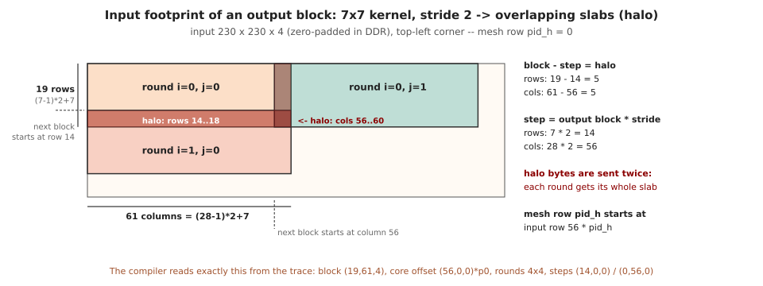

# 7.2 Special data flow: input halo (overlapping windows)

> **Data flow: halo.** Neighbouring output blocks of a convolution read
> **overlapping** input windows. The DMA does not share the overlap: it simply
> sends the overlapping rows and columns again with every window. This chapter
> follows that one pattern from the kernel line to the BD address pattern, the
> locks, the buffer lifetimes and the cost. The broadcast that carries the same
> windows to a whole mesh row is chapter [7.1](1_broadcast.md).

> **Status.** Doc only: no new example. The program is the chapter 1b conv2d
> (`example/tileprogram/ccode/simpleconv2dkernel_port.cc`).
> All refs are checked against base `43fcb8f` by script/check_refs.sh.

## The whole program

The whole program -- kernel and host, 4x4 mesh (the listing is kept in sync with
the source by `tutorial/aieprogram/sync_code.py`).

<!-- code: example/tileprogram/ccode/simpleconv2dkernel_port.cc -->
```cpp
#include "simpleconv2d_new_load.h"
#pragma aie_debug_level(2 | AIE_DEBUG_FLAG_DISABLE_PARTITIONTEARDOWN | AIE_DMA_ISSUE_COUNT)
__global__ void conv2d_spatial(aie::port<input_window_int8 *, aie::IFM, aie::shape<230, 230, 4>> win_a,
                               aie::port<input_window_int8 *, aie::WEIGHTS, aie::shape<64, 7, 7, 4>> win_b,
                               aie::port<output_window_int8 *, aie::OFM, aie::shape<112, 112, 64>> win_c) {
    // The operator and the tiling live in the kernel.
    const int KH = 7, KW = 7, S = 2, C = 4;         // 7x7 stride-2 conv, 4 (aligned) channels
    const int oh_t = 7, ow_t = 28, oc_t = 16;       // output block computed per round
    const int ih_t = (oh_t - 1) * S + KH;           // 19: input footprint of one output block
    const int iw_t = (ow_t - 1) * S + KW;           // 61
    const int oh_core = 112 / aie::num_programs(0); // 28 output rows per mesh row
    const int TAPS = KH * KW * C;                   // 196
    const int ROW = iw_t * C;                       // 244 bytes per slab row
    const int pid_h = aie::program_id(0);           // mesh row: which OH band
    const int pid_c = aie::program_id(1);           // mesh col: which OC group
    using MM = aie::mmul<8, 8, 8, int8_t, int8_t>;
    aie::set_saturation(aie::saturation_mode::saturate); // int8 results clamp like the scalar reference
    const int8_t *w = aie::load_buffer(win_b, {pid_c * oc_t, 0, 0, 0}, {oc_t, KH, KW, C});
    // const int8_t *w = aie::load_buffer(win_b, {pid_c * oc_t*10, 0, 0, 0}, {oc_t, KH, KW, C});//for bug test
    alignas(64) int8_t Bp[7 * 4 * 2 * 64];
    for (int kh = 0; kh < KH; kh++)
        for (int kb = 0; kb < 4; kb++)
            for (int nb = 0; nb < 2; nb++)
                for (int k = 0; k < 8; k++)
                    for (int n = 0; n < 8; n++) {
                        const int byte = kb < 3 ? kb * 8 + k : 20 + k; // tap byte within kernel row kh
                        const bool live = kb < 3 || k >= 4;
                        Bp[(((kh * 4 + kb) * 2 + nb) * 8 + k) * 8 + n] =
                            live ? w[(nb * 8 + n) * TAPS + kh * KW * C + byte] : (int8_t)0;
                    }
    aie::release(win_b);
    const aie::accum<acc32, 64> zero = aie::zeros<acc32, 64>();

    for (int i = 0; i < oh_core / oh_t; i++) {          // 4 row blocks
        for (int j = 0; j < 112 / ow_t; j++) {          // 4 column blocks
            const int oh0 = pid_h * oh_core + i * oh_t; // output block origin
            const int ow0 = j * ow_t;
            // Its input footprint (the halo overlaps the neighbouring blocks).
            const int8_t *x = aie::load_buffer(win_a, {oh0 * S, ow0 * S, 0}, {ih_t, iw_t, C});
            int8_t *y = aie::store_buffer(win_c, {oh0, ow0, pid_c * oc_t}, {oh_t, ow_t, oc_t});

            for (int oh = 0; oh < oh_t; oh++) {
                for (int pass = 0; pass < 2; pass++) {
                    const int owA = pass * 16, owB = pass * 16 + (pass ? 4 : 8); // M-block first columns
                    MM cA0(zero), cA1(zero), cB0(zero), cB1(zero);
                    for (int kh = 0; kh < KH; kh++)
                        chess_prepare_for_pipelining chess_loop_range(7, 7) {
                            const int8_t *r = x + (oh * S + kh) * ROW;
                            const int8_t *bk = Bp + kh * 4 * 2 * 64;
                            for (int kb = 0; kb < 4; kb++)
                                chess_unroll_loop() {
                                    const int off = kb < 3 ? kb * 8 : 20;
                                    const aie::vector<int8_t, 64> aA = aie::load_unaligned_v<64>(r + owA * 8 + off, 4);
                                    const aie::vector<int8_t, 64> aB = aie::load_unaligned_v<64>(r + owB * 8 + off, 4);
                                    const aie::vector<int8_t, 64> b0 = aie::load_v<64>(bk + (kb * 2 + 0) * 64);
                                    const aie::vector<int8_t, 64> b1 = aie::load_v<64>(bk + (kb * 2 + 1) * 64);
                                    cA0.mac(aA, b0);
                                    cA1.mac(aA, b1);
                                    cB0.mac(aB, b0);
                                    cB1.mac(aB, b1);
                                }
                        }
                    // 8 columns x 16 channels = 128 contiguous output bytes:
                    // interleave the two N-blocks 8 channels at a time.
                    const int owc[2] = {owA, owB};
                    const MM *acc[2][2] = {{&cA0, &cA1}, {&cB0, &cB1}};
                    for (int m = 0; m < 2; m++) {
                        const auto z =
                            aie::interleave_zip(acc[m][0]->to_vector<int8_t>(0), acc[m][1]->to_vector<int8_t>(0), 8);
                        int8_t *o = y + (oh * ow_t + owc[m]) * oc_t; // 32-byte aligned (window base is)
                        aie::store_v(o, z.first.extract<32>(0));
                        aie::store_v(o + 32, z.first.extract<32>(1));
                        aie::store_v(o + 64, z.second.extract<32>(0));
                        aie::store_v(o + 96, z.second.extract<32>(1));
                    }
                }
            }
            aie::release(win_a);
            aie::commit(win_c);
        }
    }
}
// ═══════════════════════════════════════════════════════════════════════════
// HOST
// ═══════════════════════════════════════════════════════════════════════════
int main() {
    printf("=== Conv2d via Im2col on AIE %dx%d Mesh ===\n", HW_ROWS, HW_COLS);
    // --- Device + mesh ---
    aieSetDevice(0);
    aieArray device;
    aieMesh mesh = device.partition({3, 6, 0, 6}, HW_ROWS, HW_COLS);
    // --- Allocate host memory (DDR pre-pad: spatial border + channel layout) ---
    int8_t *input = (int8_t *)__Runtime_Alloc(INPUT_H_PAD * INPUT_W_PAD * INPUT_C_ALIGN * sizeof(int8_t));
    int8_t *filter = (int8_t *)__Runtime_Alloc(KERNEL_H * KERNEL_W * INPUT_C_ALIGN * NUM_FILTERS * sizeof(int8_t));
    int8_t *output = (int8_t *)__Runtime_Alloc(OUTPUT_H * OUTPUT_W * NUM_FILTERS * sizeof(int8_t));
    // --- Initialize test data ---
    memset(input, 0, INPUT_H_PAD * INPUT_W_PAD * INPUT_C_ALIGN * sizeof(int8_t));
    for (int h = 0; h < INPUT_H; h++) {
        for (int w = 0; w < INPUT_W; w++) {
            for (int c = 0; c < INPUT_C; c++) {
                int real_idx = (h * INPUT_W + w) * INPUT_C + c;
                int val = (int)(mix32((uint32_t)real_idx + INPUT_SEED) % 9u) - 4; // [-4, 4]
                input[((h + PAD) * INPUT_W_PAD + (w + PAD)) * INPUT_C_ALIGN + c] = (int8_t)val;
            }
            // padding channels [INPUT_C, INPUT_C_ALIGN) and spatial border left at 0
        }
    }
    // Filter: zero-mean samples in {-1, 0, 1} for the real channels, 0 for the
    memset(filter, 0, KERNEL_H * KERNEL_W * INPUT_C_ALIGN * NUM_FILTERS * sizeof(int8_t));
    for (int f = 0; f < NUM_FILTERS; f++) {
        for (int kh = 0; kh < KERNEL_H; kh++) {
            for (int kw = 0; kw < KERNEL_W; kw++) {
                for (int c = 0; c < INPUT_C; c++) {
                    int kk = (kh * KERNEL_W + kw) * INPUT_C_ALIGN + c;
                    int filt_key = ((f * KERNEL_H + kh) * KERNEL_W + kw) * INPUT_C + c;
                    int val = (int)(mix32((uint32_t)filt_key + FILTER_SEED) % 3u) - 1; // {-1,0,1}
                    filter[f * K + kk] = (int8_t)val;
                }
                // padding channel c == INPUT_C..INPUT_C_ALIGN-1 left at 0
            }
        }
    }
    memset(output, 0, OUTPUT_H * OUTPUT_W * NUM_FILTERS * sizeof(int8_t));
    printf("\n--- Launching conv2d_spatial (spatial-halo) on AIE ---\n");
    XTime t_aie_start, t_aie_end;
    XTime_GetTime(&t_aie_start);
    conv2d_spatial<<<mesh>>>(input, filter, output, M, N, K);
    XTime_GetTime(&t_aie_end);
    double aie_wall_ms = 1.0 * (t_aie_end - t_aie_start) / COUNTS_PER_SECOND * 1000.0;
    printf("[BENCH] aie_wall_ms=%.3f\n", aie_wall_ms);
    free(input);
    free(filter);
    free(output);
    return 0;
}
```
<!-- /code -->

## 1. The idea: neighbouring output blocks need overlapping input

A 7x7 stride-2 convolution computes each core's output in blocks of 7 rows x
28 columns x 16 channels. One output block needs an input **footprint** that
is larger than the step between two blocks. Chapter 1b states it in the kernel
(`tutorial/aieprogram/01_contraction/conv2d.md:25`, quoted word for word):

```cpp
    const int ih_t = (oh_t - 1) * S + KH;           // 19: input footprint of one output block
```
<!-- ref tutorial/aieprogram/01_contraction/conv2d.md:25 const int ih_t = (oh_t - 1) * S + KH; -->

and the overlap in the text
(`tutorial/aieprogram/01_contraction/conv2d.md:113-117`, quoted word for word):

> starting at input row `2 oh0`, column `2 ow0`. The next block down starts 7
> output rows = 14 input rows lower, the next block right 28 columns = 56 input
> columns further -- but each footprint is 19 rows / 61 columns tall / wide, so
> **consecutive footprints overlap by 5**. That overlap is the halo; the DMA
> simply sends those rows twice.
<!-- ref tutorial/aieprogram/01_contraction/conv2d.md:116 **consecutive footprints overlap by 5** -->
<!-- ref tutorial/aieprogram/01_contraction/conv2d.md:113-117 simply sends those rows twice. -->

So the numbers of this chapter are:

| quantity | rows | columns | channels |
|---|---|---|---|
| footprint (one window) | 19 = (7 - 1) * 2 + 7 | 61 = (28 - 1) * 2 + 7 | 4 |
| step between windows | 14 (7 output rows x stride 2) | 56 (28 output columns x stride 2) | -- |
| overlap (halo) | 19 - 14 = 5 | 61 - 56 = 5 | -- |



## 2. The kernel: which line makes a halo

A halo is not declared. It follows from one `aie::load_buffer` whose offset
moves by less than its shape
(`example/tileprogram/ccode/simpleconv2dkernel_port.cc:36-39`):

```cpp
            const int oh0 = pid_h * oh_core + i * oh_t; // output block origin
            const int ow0 = j * ow_t;
            // Its input footprint (the halo overlaps the neighbouring blocks).
            const int8_t *x = aie::load_buffer(win_a, {oh0 * S, ow0 * S, 0}, {ih_t, iw_t, C});
```
<!-- ref example/tileprogram/ccode/simpleconv2dkernel_port.cc:36-39 aie::load_buffer(win_a, {oh0 * S, ow0 * S, 0}, {ih_t, iw_t, C}) -->
<!-- ref example/tileprogram/ccode/simpleconv2dkernel_port.cc:36 const int oh0 = pid_h * oh_core + i * oh_t; -->
<!-- ref example/tileprogram/ccode/simpleconv2dkernel_port.cc:38 the halo overlaps the neighbouring blocks -->

| term | value | step per round | shape | overlap |
|---|---|---|---|---|
| row offset `oh0 * S` | `2 * (28 pid_h + 7 i)` = 56 pid_h + 14 i | 14 (`i`) | `ih_t` = 19 | 5 |
| column offset `ow0 * S` | `2 * 28 j` = 56 j | 56 (`j`) | `iw_t` = 61 | 5 |
| channel offset | 0 | -- | `C` = 4 | none |

Rule: when the offset of a load moves by less than its shape between rounds,
consecutive windows overlap; the overlap is shape minus step. The kernel does
not handle it: every round gets its full 19 x 61 x 4 window, and
`aie::release(win_a)` (`example/tileprogram/ccode/simpleconv2dkernel_port.cc:78`)
gives the buffer back so the DMA can write the next window.
<!-- ref example/tileprogram/ccode/simpleconv2dkernel_port.cc:78 aie::release(win_a); -->

The kernel analysis reports exactly these blocks and steps
(`tutorial/aieprogram/01_contraction/conv2d.md:314`) and marks the routing
plan as `(halo)` (`tutorial/aieprogram/01_contraction/conv2d.md:317`).
<!-- ref tutorial/aieprogram/01_contraction/conv2d.md:314 block (19,61,4), core offset (56,0,0)*p0 + (0,0,0)*p1, rounds 4x4 steps (14,0,0) / (0,56,0) -->
<!-- ref tutorial/aieprogram/01_contraction/conv2d.md:317 routing plan on the 4x4 mesh (halo): -->

## 3. The blocks: what the DMA sends per core

One window is 19 x 61 x 4 = 4636 bytes
(`tutorial/aieprogram/01_contraction/conv2d.md:194`). A core runs 4 x 4 = 16
rounds (`i` outer, `j` inner), so it receives 16 windows = 74,176 bytes of
input.
<!-- ref tutorial/aieprogram/01_contraction/conv2d.md:194 19 x 61 x 4 = 4636 bytes -->

The unique input rows of one mesh-row band are 56 pid_h .. 56 pid_h + 60
(61 rows: last window starts at +42 and is 19 tall); the unique columns are
0 .. 228 (229 columns: last window starts at 168 and is 61 wide). Unique bytes
per band = 61 x 229 x 4 = 55,876. The halo therefore costs
74,176 / 55,876 = 1.33x the unique input bytes per core (computed from the
numbers above, not measured).

### ASCII data path (one mesh row, rows only)

```
DDR win_a (230 x 230 x 4, pre-padded)
  band pid_h: input rows 56 pid_h .. 56 pid_h + 60
     i=0  rows +0  .. +18   |-------19-------|
     i=1  rows +14 .. +32                |xxxx|-------19-------|
     i=2  rows +28 .. +46                                   |xxxx|-------19-------|
     i=3  rows +42 .. +60   (each |xxxx| = the 5 overlapping rows, sent twice)
         |
         v  shim MM2S, one BD walk per window (4 x 4 windows, j inner: columns +0, +56, +112, +168)
  stream switch: row broadcast to the 4 cores of mesh row pid_h (chapter 7.1)
         |
         v  tile S2MM into the window buffer (ping / pong, 4636 B each)
  core: aie::load_buffer(win_a, ...)  ->  7 x 28 x 16 outputs  ->  aie::release(win_a)
```

The overlap lives only in the **address pattern** of the shim BD (step 14 <
shape 19, step 56 < shape 61). Nothing downstream knows about it: the stream,
the tile BD and the core see 16 independent 4636-byte windows.

## 4. BD / lock sequence

The rows below are Amit's (task `2026-11-21_tut07-halo`), pasted unchanged.

PROBE lowered_conv2d_bds=no example/tileprogram/ccode/simpleconv2dkernel_port.cc src/aietensorop/conv2dstem/conv2dstem.cc (43fcb8f: no XAie_DmaSetLock / XAie_DmaSetAddrLen in either dir; git grep rc=1)

## Halo flow (conv2d 1b): BD / lock table

BD shapes derived from conv2d.md, not lowered 1b output. 43fcb8f has no lowered
1b host/routing code for `conv2d_spatial`, so no BD ids, lock ids or lock values
are given here; only the shapes and the acquire/release rule.

Source facts:
- Ports: IFM `win_a` (230,230,4), WEIGHTS `win_b` (64,7,7,4), OFM `win_c` (112,112,64). <!-- ref example/tileprogram/ccode/simpleconv2dkernel_port.cc:3-5 aie::IFM -->
- Mesh position: `pid_h = program_id(0)` picks the OH band, `pid_c = program_id(1)` the OC group. <!-- ref example/tileprogram/ccode/simpleconv2dkernel_port.cc:14-15 program_id -->
- Footprint per output block: ih_t = 19 rows, iw_t = 61 columns, 4 channels. <!-- ref tutorial/aieprogram/01_contraction/conv2d.md:25 ih_t -->
- Consecutive footprints overlap by 5 rows/columns; the DMA sends those rows twice. <!-- ref tutorial/aieprogram/01_contraction/conv2d.md:116 overlap -->
- Routing plan: win_a row broadcast, 4x4 blocks/core, d1 = rows/4 at 56 + i4 x 19 step 14, d2 = j4 x 61 step 56. <!-- ref tutorial/aieprogram/01_contraction/conv2d.md:317-321 d1[230]=rows/4@56+i4x19@14 -->

| Row | Side | Resource | Shape / rule | Source |
|---|---|---|---|---|
| B1 | IFM halo BD (MM2S toward the mesh row) | 19 x 61 x 4 block of `win_a`, origin (2 oh0, 2 ow0) | 4x4 rounds per core, steps 14 rows / 56 columns; rows 15..19 of one block are rows 1..5 of the next (overlap 5) | <!-- ref tutorial/aieprogram/01_contraction/conv2d.md:318 win_a --> |
| B2 | IFM load on the core | `aie::load_buffer(win_a, {oh0*S, ow0*S, 0}, {ih_t, iw_t, C})` | one footprint per (i, j) round, 16 rounds | <!-- ref example/tileprogram/ccode/simpleconv2dkernel_port.cc:36-39 load_buffer --> |
| B3 | BD programming call | address + length, then lock pair, then next BD | runtime writes address/length before the lock pair | <!-- ref src/mlir/runtime/aie_runtime.c:3681 XAie_DmaSetAddrLen --> |
| L1 | Producer (DMA writes the halo block into the tile buffer) | lock pair of the IFM BD | rule: the BD acquires the "buffer free" lock before writing the 19x61x4 block and releases the "buffer full" lock after it; ids/values not in 43fcb8f | <!-- ref src/mlir/runtime/aie_runtime.c:3684 XAie_DmaSetLock --> |
| L2 | Consumer (core reads the block via load_buffer) | the same lock pair, opposite direction | rule: the core acquires "buffer full" before reading the footprint and releases "buffer free" after the round, so the next (overlapping) footprint can be written | <!-- ref src/mlir/runtime/aie_runtime.c:3684-3685 XAie_LockInit --> |
| L3 | Weights consumer (win_b, loaded once) | weight buffer lock | rule: acquired once by load_buffer, released by `aie::release(win_b)` after packing; not per round | <!-- ref example/tileprogram/ccode/simpleconv2dkernel_port.cc:31 aie::release --> |

Notes: the halo needs no extra lock: each round is one acquire/release pair on
the same buffer; the overlap is only in the BD address pattern (step 14 < 19).

## 5. Lifecycle: who allocates, owns and frees

Sequence for one launch: **load -> allocate -> configure -> run -> sync -> release**.
For the halo the only new point is that one window buffer is refilled 16 times
with overlapping data; ownership flips between DMA and core every round.

| Resource | Allocated by | Configured by | Owned by (while live) | Released by |
|---|---|---|---|---|
| Partition / mesh (`device.partition`) | host `main` (`example/tileprogram/ccode/simpleconv2dkernel_port.cc:91`) | runtime at load | runtime, whole program | `__Runtime_device_teardown` -> `XAie_PartitionTeardown` (`src/mlir/runtime/aie_runtime.c:3291-3298`); this example sets `AIE_DEBUG_FLAG_DISABLE_PARTITIONTEARDOWN` (`example/tileprogram/ccode/simpleconv2dkernel_port.cc:2`), so here the teardown is skipped |
| DDR input `win_a` (the halo source), filter, output | host `main` via `__Runtime_Alloc` (`example/tileprogram/ccode/simpleconv2dkernel_port.cc:93-95`), 64-byte aligned (`src/mlir/runtime/aie_runtime.c:2481-2484`) | host fills it before the launch | host; lent to the shim BDs during `conv2d_spatial<<<mesh>>>` (`example/tileprogram/ccode/simpleconv2dkernel_port.cc:127`) | host `free` (`example/tileprogram/ccode/simpleconv2dkernel_port.cc:131-133`) |
| Shim MM2S BD walking the 16 overlapping windows | compiler at lowering: `RoutingTile::allocateBd` (`src/mlir/mlirfront/tilinglinalg/pass/routingimplement/hw/ResourceManager.cpp:125`) | runtime at load: address + length (`src/mlir/runtime/aie_runtime.c:3681`) | shim DMA until the BD chain ends | partition teardown (no per-BD release call at 43fcb8f) |
| Tile window buffer (ping / pong, 4636 B) + S2MM BD | compiler at lowering (same allocator) | runtime at load (same call) | DMA while it writes a window; the core between `aie::load_buffer` and `aie::release(win_a)` | the kernel, each round, `aie::release(win_a)` (`example/tileprogram/ccode/simpleconv2dkernel_port.cc:78`) |
| Lock pair guarding the window buffer | compiler at lowering: `RoutingTile::allocateLockPair` (`src/mlir/mlirfront/tilinglinalg/pass/routingimplement/hw/ResourceManager.cpp:186`) | runtime at load: `XAie_DmaSetLock` on the BD (`src/mlir/runtime/aie_runtime.c:3684-3685`) | per tile, alternately DMA and core (rows L1, L2) | partition teardown |

<!-- ref example/tileprogram/ccode/simpleconv2dkernel_port.cc:91 device.partition({3, 6, 0, 6}, HW_ROWS, HW_COLS) -->
<!-- ref example/tileprogram/ccode/simpleconv2dkernel_port.cc:2 AIE_DEBUG_FLAG_DISABLE_PARTITIONTEARDOWN -->
<!-- ref example/tileprogram/ccode/simpleconv2dkernel_port.cc:93-95 __Runtime_Alloc -->
<!-- ref example/tileprogram/ccode/simpleconv2dkernel_port.cc:127 conv2d_spatial<<<mesh -->
<!-- ref example/tileprogram/ccode/simpleconv2dkernel_port.cc:131-133 free(input); -->
<!-- ref src/mlir/runtime/aie_runtime.c:3291-3298 XAie_PartitionTeardown(dev) -->
<!-- ref src/mlir/runtime/aie_runtime.c:3291-3298 DISABLE_PARTITIONTEARDOWN -->
<!-- ref src/mlir/runtime/aie_runtime.c:2481-2484 aligned_alloc(64, aligned_bytes) -->
<!-- ref src/mlir/runtime/aie_runtime.c:3681 XAie_DmaSetAddrLen(&DmaInst, dma_addr, (uint32_t)len); -->
<!-- ref src/mlir/runtime/aie_runtime.c:3684-3685 XAie_DmaSetLock(&DmaInst, XAie_LockInit(acquire_lock_id, acquire_lock_val), -->
<!-- ref src/mlir/mlirfront/tilinglinalg/pass/routingimplement/hw/ResourceManager.cpp:125 RoutingTile::allocateBd(int ownerId) -->
<!-- ref src/mlir/mlirfront/tilinglinalg/pass/routingimplement/hw/ResourceManager.cpp:186 RoutingTile::allocateLockPair(int ownerId, int &lockA, int &lockB) -->
<!-- sym __Runtime_device_teardown -->

Rules that follow from the table:

- The host owns `win_a` for the whole launch. The overlapping rows are read
  from DDR once per window, so do not rewrite the input before
  `conv2d_spatial<<<mesh>>>` returns.
- A window buffer is refilled only after the core's `aie::release(win_a)`.
  The halo adds no lock: each round is one acquire/release pair on the same
  buffer (rows L1, L2).
- Nothing on the halo path is freed per BD at this base; the partition
  teardown is the single release point, and this example disables it.

## 6. What it costs

**Extra DDR and stream bytes.** Each core moves 16 windows of 4636 B =
74,176 B for 55,876 unique bytes: 1.33x (section 3). The repeated bytes are
the 5-row and 5-column overlaps. This is the price of keeping every window
self-contained; the alternative (keep the overlap in core memory and send only
the new 14 rows / 56 columns) needs a sliding buffer that the 1b lowering does
not build.

**No extra locks or BDs.** The halo changes only the shim BD's address
pattern; the window buffer, its lock pair and the core loop are the same as
for a non-overlapping tiling.

Takeaway: an input halo is a load whose step is smaller than its shape; the
DMA pays for it by resending the overlap (here 5 rows and 5 columns, 1.33x
the bytes), and the runtime sees nothing special.
